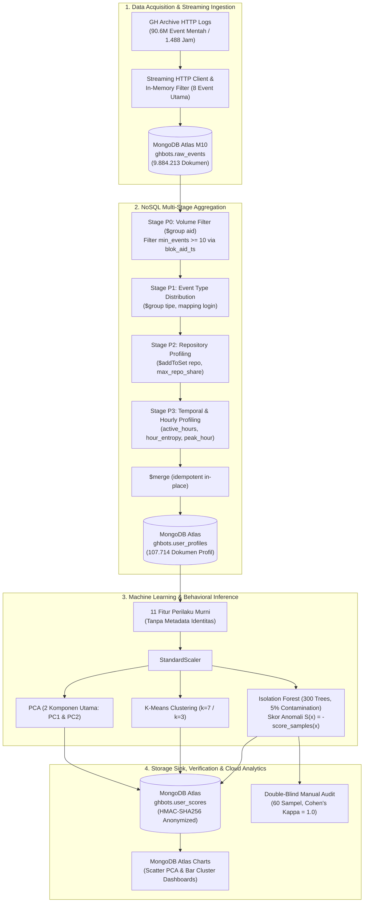

# CONTEXT.md: Deteksi dan Klasterisasi Akun Bot pada Aktivitas GitHub Menggunakan MongoDB Atlas, Isolation Forest, dan K-Means

> **Single-Source of Truth (SSOT)** komprehensif, padat informasi, dan mendalam mengenai arsitektur sistem, rekayasa data NoSQL, metodologi machine learning, hasil eksperimen empiris, tipologi bot nyata, dan pemetaan repositori riset.

---

## 1. Executive Metadata

| Atribut | Rincian Spesifikasi |
|---|---|
| **Judul Penelitian** | Deteksi dan Klasterisasi Akun Bot pada Aktivitas GitHub Menggunakan MongoDB Atlas, Isolation Forest, dan K-Means |
| **Subjudul** | Studi Eksperimental Big Data & NoSQL Berbasis GH Archive (PBL Big Data 2026) |
| **Penulis & Afiliasi** | **Ryanda Valents Anakri** (NIM: 2303113649) & Tim Kelompok 4 Big Data<br>Program Studi S-1 Sistem Informasi, Jurusan Ilmu Komputer, Fakultas MIPA, Universitas Riau |
| **Dosen Pengampu & Pembimbing** | **Assoc. Prof. Dr. Rahmad Kurniawan, ST., MIT.** |
| **Target Publikasi Ilmiah** | *Journal of Intelligent Computing Methods (JICM)* — Volume 4, Nomor 2, 2026 |
| **Cakupan Temporal Dataset** | Log Publik GitHub Archive (GH Archive), periode observasi Agustus – Oktober 2026 |
| **Skala Data Mentah** | 90,6 Juta event mentah (1.488 jam pengamatan arsip global) |
| **Skala Data Bersih (Filtered)** | **9.884.213 event bersih** dari **152 jam pengamatan terkurasi** tanpa missing-hour:<br>&bull; **Blok A:** 78 jam (11–14 Okt 2026) = 6.244.807 event<br>&bull; **Blok B:** 74 jam (19–22 Okt 2026) = 3.639.406 event |
| **Total Profil Teragregasi** | **107.714 profil akun unik** diekstraksi ke koleksi `user_profiles` |
| **Stack Teknologi** | &bull; **Data Storage & Query Engine:** MongoDB Atlas (M10 Cluster, 2 vCPU, 2 GB RAM, Storage WiredTiger ~1 GB terkompresi)<br>&bull; **Machine Learning & Analytics:** Python 3.10+, Scikit-Learn v1.3+ (`IsolationForest`, `KMeans`, `PCA`, `StandardScaler`), Pandas, NumPy, SciPy<br>&bull; **Visualisasi & Cloud Dashboard:** MongoDB Atlas Charts, Matplotlib, Seaborn<br>&bull; **Orkestrasi Eksekusi:** Google Colab Environment |

---

## 2. Definisi Masalah & Research Questions

### 2.1 Konteks Permasalahan
GitHub merupakan platform kolaborasi perangkat lunak terbesar di dunia. Keberadaan otomasi perangkat lunak (bot) resmi sangat umum dan umumnya transparan melalui akhiran nama `[bot]` (misalnya `dependabot[bot]`, `codecov[bot]`). Namun, ekosistem open-source menghadapi lonjakan masif dari **stealth bot**—yaitu bot yang didaftarkan menggunakan akun pengguna biasa (*user accounts*) tanpa tag resmi, yang beroperasi menyerupai akun manusia biasa.

Stealth bot beroperasi untuk berbagai tujuan destruktif maupun informal:
1. **Black-Hat SEO & Web Spam:** Eksploitasi repositori publik dengan ribuan commit/issue berisi tautan backlink judi online, kasino, dan malware untuk mendongkrak PageRank mesin pencari.
2. **Contribution Graph Fraud (Green-Wall Spoofing):** Skrip loop tak terhingga (*infinite commit loops*) yang membuat commit artifisial setiap jam untuk memalsukan grafik hijau portofolio pengembang.
3. **Unregulated CI Runners & Resource Abuse:** Runner pengujian mandiri tanpa batas laju (*rate limits*) yang membanjiri feed aktivitas publik.
4. **Algorithmic Trading Auto-Deployers:** Bot trading valas/kripto yang melakukan commit berkala (misal tiap 15 menit) untuk menyinkronkan status Expert Advisor (EA).

### 2.2 Keterbatasan Pendekatan Konvensional
Pendekatan konvensional yang menyaring bot murni berdasarkan ambang volume event (*threshold-based volume*) mengalami dua kelemahan fatal:
- **False Negatives:** Stealth bot modern sengaja membatasi kecepatan aktivitas untuk menghindari *rate limiting* GitHub API, sehingga lolos dari saringan volume tinggi.
- **False Positives:** Pengembang manusia berkinerja tinggi (*super-maintainers*) sering menghasilkan volume event sangat besar saat merilis perangkat lunak atau memelihara puluhan repositori.

Oleh karena itu, diperlukan pendekatan multidimensi tanpa pengawasan (*unsupervised*) yang memodelkan **perilaku murni (behavioral profiling)** secara independen dari identitas akun, dipadukan dengan mesin basis data terdistribusi NoSQL untuk pemrosesan skala multi-juta data.

### 2.3 Research Questions (RQ)

```
┌────────────────────────────────────────────────────────────────────────────────────────┐
│                                RESEARCH QUESTIONS (RQ)                                 │
├──────┬─────────────────────────────────────────────────────────────────────────────────┤
│ RQ1  │ Efektivitas Deteksi Anomali vs Baseline Volume:                                 │
│      │ Sejauh mana model unsupervised Isolation Forest berbasis 11 fitur perilaku      │
│      │ mampu mengungguli baseline volume univariat dan ekspektasi acak dalam           │
│      │ mengidentifikasi akun bot?                                                      │
├──────┼─────────────────────────────────────────────────────────────────────────────────┤
│ RQ2  │ Karakteristik Klaster Perilaku Otomasi (K-Means & PCA):                         │
│      │ Bagaimana tipologi perilaku bot dan pengembang terpetakan dalam ruang dimensi   │
│      │ tereduksi melalui K-Means clustering (k=7) dan 2D PCA?                          │
├──────┼─────────────────────────────────────────────────────────────────────────────────┤
│ RQ3  │ Kestabilan Temporal Lintas Waktu (Cross-Block Generalizability):                │
│      │ Apakah skor anomali perilaku yang dihasilkan model bersifat stabil dan          │
│      │ konsisten lintas jendela waktu independen (Blok A vs Blok B)?                   │
├──────┼─────────────────────────────────────────────────────────────────────────────────┤
│ RQ4  │ Optimasi Skema & Indeks Basis Data NoSQL MongoDB Atlas:                         │
│      │ Bagaimana pengaruh skema dokumen, indeks compound (blok_aid_ts), dan indeks      │
│      │ temporal (ts_1) terhadap performa kueri agregasi skala multi-juta dokumen?     │
└──────┴─────────────────────────────────────────────────────────────────────────────────┘
```

---

## 3. Data Engineering & Arsitektur NoSQL MongoDB Atlas

### 3.1 Pipeline End-to-End



### 3.2 Karakteristik & Volume Dataset
- **Sumber Data:** Repositori arsip publik [GH Archive](https://www.gharchive.org/) berupa berkas JSON terkompresi per jam (`YYYY-MM-DD-H.json.gz`).
- **Skala Ingesti Awal:** Dari 90,6 juta event mentah (1.488 jam) selama periode Agustus s.d. Oktober 2026, sistem menyaring dua blok jam observasi kontinu yang terverifikasi bersih tanpa *missing hour*:
  - **Blok A (Training & Profiling 1):** 11 Oktober 2026 08:00 UTC s.d. 14 Oktober 2026 13:00 UTC (**78 jam kontinu**, 6.244.807 event bersih).
  - **Blok B (Evaluasi & Generalisasi 2):** 19 Oktober 2026 12:00 UTC s.d. 22 Oktober 2026 13:00 UTC (**74 jam kontinu**, 3.639.406 event bersih).
  - **Total Volume Terkurasi:** **9.884.213 dokumen event**.
- **In-Memory Streaming Filter:** Ingesti dilakukan tanpa menyimpan puluhan gigabyte berkas mentah ke disk Colab. Hanya 8 jenis event GitHub inti yang dipertahankan: `PushEvent`, `CreateEvent`, `PullRequestEvent`, `PullRequestReviewEvent`, `PullRequestReviewCommentEvent`, `IssuesEvent`, `IssueCommentEvent`, `WatchEvent`, dan `ForkEvent`.

### 3.3 Skema Koleksi Basis Data NoSQL

#### Koleksi 1: `raw_events`
Menyimpan setiap rekaman event tunggal dari GitHub Archive.
```javascript
{
  "_id":   NumberLong("12345678901"), // ID numerik event GitHub (Primary Key unik, idempotensi)
  "aid":   NumberInt(9876543),         // ID numerik akun aktor (Actor ID)
  "login": "username_sample",          // Username akun GitHub aktor
  "t":     "PushEvent",                // Tipe event (String ringkas)
  "repo":  NumberInt(54321098),        // ID numerik repositori GitHub
  "ts":    ISODate("2026-10-11T08:15:30Z"), // Timestamp UTC (BSON Date)
  "blok":  "A",                        // Indikator jendela temporal ("A" atau "B")
  "n":     null                        // Payload commit count (umumnya null di GH Archive 2026)
}
```

#### Koleksi 2: `user_profiles`
Menyimpan ringkasan profil perilaku per akun per blok hasil komputasi multi-stage aggregation pipeline. Total dokumen: **107.714 profil**.
```javascript
{
  "_id": "A_9876543",                  // ID gabungan {blok}_{aid}
  "blok": "A",
  "aid": NumberInt(9876543),
  "login": "username_sample",
  "n": 150,                            // Total event dalam blok
  "n_repos": 3,                        // Jumlah repositori unik yang disentuh
  "max_repo": 130,                     // Jumlah event di repositori paling dominan
  "jam_aktif": 42,                     // Jumlah jam unik dengan minimal 1 event
  "max_per_jam": 25,                   // Beban aktivitas puncak dalam satu jam
  "n_push": 130,                       // Hitungan PushEvent
  "n_create": 10,                      // Hitungan CreateEvent
  "n_pr": 5,                           // Hitungan aktivitas Pull Request
  "n_issue": 3,                        // Hitungan aktivitas Issue
  "n_social": 2,                       // Hitungan WatchEvent + ForkEvent
  "hod": [0, 1, 4, 12, ... 24 elemen]  // Distribusi aktivitas per Hour of Day (0-23 UTC)
}
```

#### Koleksi 3: `user_scores`
Menyimpan hasil inferensi model machine learning untuk kebutuhan pelaporan analitik di Atlas Charts.
```javascript
{
  "_id": "A_9876543",
  "blok": "A",
  "id_anon": "u_a1b2c3d4e5f67890",      // Pseudonim HMAC-SHA256 untuk akun non-bot
  "login_bot": "",                     // String kosong untuk non-bot; terisi hanya jika [bot] resmi
  "skor_anomali": 0.1845,              // Skor anomali kontinu Isolation Forest
  "ditandai": true,                    // Flag True jika berada di top-5% skor tertinggi
  "klaster": 3,                        // ID klaster K-Means (0 s.d. 6)
  "pc1": 2.451,                        // Proyeksi koordinat PCA komponen 1
  "pc2": -1.108,                       // Proyeksi koordinat PCA komponen 2
  "label_bot": false                   // Indikator heuristik sufiks [bot]
}
```

### 3.4 Desain Indexing NoSQL
1. **Compound Index `blok_aid_ts`:** `{ blok: 1, aid: 1, ts: 1 }`
   - Berfungsi mempercepat pencarian data akun dalam blok temporal tertentu serta mendukung penyortiran berbasis waktu tanpa memerlukan in-memory sort. Digunakan intensif pada pipeline agregasi P0 s.d. P3.
2. **Range Index `ts_1`:** `{ ts: 1 }`
   - Berfungsi melayani kueri analitik berbasis rentang waktu temporal (misalnya agregasi event per jam atau per rentang jendela 6–48 jam).

### 3.5 Multi-Stage Aggregation Pipeline (P0 – P3)
Penyusunan 107.714 profil akun dilakukan secara terdistribusi di dalam engine MongoDB Atlas menggunakan 4 tahapan agregasi:
- **Pipeline P0 (Ambang Batas Keaktifan):** Memindai `raw_events` per blok menggunakan indeks `blok_aid_ts`, mengelompokkan `$group: { _id: "$aid" }`, dan memfilter akun yang memiliki total aktivitas $n \ge 10$.
- **Pipeline P1 (Distribusi Tipe Aktivitas):** Menghitung frekuensi kemunculan tiap tipe event (`n_push`, `n_create`, `n_pr`, `n_issue`, `n_social`) dan memetakan string identitas `login`.
- **Pipeline P2 (Pola Repositori):** Mengakumulasikan himpunan ID repositori unik via operator `$addToSet: "$repo"`, menghitung $n_{\text{repos}}$, serta mengidentifikasi konsentrasi event tertinggi pada repositori tunggal ($n_{\text{max\_repo}}$).
- **Pipeline P3 (Metrik Temporal & Entropi):** Menghitung jumlah jam aktif unik ($j_{\text{aktif}}$), menghitung lonjakan event maksimal dalam satu jam ($\max(n_h)$), dan menyusun histogram sebaran 24 jam sehari (*Hour of Day / HOD*).
- **In-Place Merge:** Seluruh statistik digabungkan dan disimpan langsung ke koleksi `user_profiles` menggunakan operator `$merge` dengan mekanisme *upsert* berbasis kunci `{ blok, aid }`.

---

## 4. Machine Learning & Behavioral Metrics

### 4.1 Prinsip Rekayasa Fitur Bebas Bias (Leak-Free Engineering)
Untuk mencegah model menghafal identitas akun atau nama repositori, seluruh proses pemodelan **hanya menggunakan 11 fitur perilaku murni**. Informasi identitas akun (`login`, `aid`) maupun nama repositori (`repo`) sama sekali tidak diikutsertakan ke dalam matriks fitur.

### 4.2 Formulasi Matematis 11 Fitur Perilaku

```
┌────────────────────────────────────────────────────────────────────────────────────────┐
│                        11 FITUR PERILAKU MURNI (BEHAVIORAL FEATURES)                   │
├──────┬──────────────────────┬─────────────────────────────┬────────────────────────────┤
│ No   │ Nama Fitur           │ Formulasi Matematis         │ Rasionalisasi Perilaku     │
├──────┼──────────────────────┼─────────────────────────────┼────────────────────────────┤
│ 1    │ log_n                │ ln(1 + n)                   │ Meredam skewness ekstrem   │
│      │                      │                             │ distribusi power-law event │
├──────┼──────────────────────┼─────────────────────────────┼────────────────────────────┤
│ 2    │ frac_push            │ n_push / n                  │ Fraksi aktivitas push kode │
├──────┼──────────────────────┼─────────────────────────────┼────────────────────────────┤
│ 3    │ frac_create          │ n_create / n                │ Fraksi pembuatan entitas   │
│      │                      │                             │ repo, branch, atau tag     │
├──────┼──────────────────────┼─────────────────────────────┼────────────────────────────┤
│ 4    │ frac_pr              │ n_pr / n                    │ Keterlibatan dalam PR      │
│      │                      │                             │ (open, review, komentar)   │
├──────┼──────────────────────┼─────────────────────────────┼────────────────────────────┤
│ 5    │ frac_issue           │ n_issue / n                 │ Interaksi tiket & masalah  │
│      │                      │                             │ (open, komentar issue)     │
├──────┼──────────────────────┼─────────────────────────────┼────────────────────────────┤
│ 6    │ frac_social          │ n_social / n                │ Aktivitas jejaring sosial  │
│      │                      │                             │ (Watch/Star & Fork)        │
├──────┼──────────────────────┼─────────────────────────────┼────────────────────────────┤
│ 7    │ log_events_per_repo  │ ln(1 + n / n_repos)         │ Intensitas event per repo  │
│      │                      │                             │ (fokus vs menyebar tipis)  │
├──────┼──────────────────────┼─────────────────────────────┼────────────────────────────┤
│ 8    │ max_repo_share       │ n_max_repo / n              │ Derajat monopoli aktivitas │
│      │                      │                             │ pada satu repo (0 s.d. 1)  │
├──────┼──────────────────────┼─────────────────────────────┼────────────────────────────┤
│ 9    │ hour_entropy         │ -∑ p_i log2(p_i) / log2(24) │ Entropi Shannon sebaran    │
│      │                      │ (untuk i = 1 s.d. 24)       │ 24 jam (0=1 jam; 1=merata) │
├──────┼──────────────────────┼─────────────────────────────┼────────────────────────────┤
│ 10   │ active_frac          │ j_aktif / J_blok            │ Proporsi jam aktif         │
│      │                      │                             │ terhadap panjang blok jam  │
├──────┼──────────────────────┼─────────────────────────────┼────────────────────────────┤
│ 11   │ log_max_per_hour     │ ln(1 + max(n_h))            │ Logaritma lonjakan event   │
│      │                      │                             │ tertinggi dalam 1 jam      │
└──────┴──────────────────────┴─────────────────────────────┴────────────────────────────┘
```

> **Catatan Teknis Krusial Mengenai `commits_per_push`:**
> Pada rancangan awal analitik GitHub, metrik `commits_per_push` direncanakan untuk mengukur rata-rata jumlah commit per push event. Namun, pada format payload skema GH Archive periode 2026, field `payload.commits` ditiadakan/dikosongkan untuk optimasi bandwidth publik. Oleh karena itu, metrik ini **secara eksplisit dibuang** dari pipeline untuk menjamin integritas komputasi tanpa nilai *missing* artifisial.

### 4.3 Pipeline Pemodelan Unsupervised
1. **Standardisasi:** Matriks 11 dimensi dinormalisasi menggunakan `StandardScaler` sehingga memiliki rata-rata $\mu = 0$ dan varians $\sigma^2 = 1$.
2. **Isolation Forest:**
   - Parameter: `n_estimators=300`, `contamination=0.05` (ambang batas top 5% populasi paling anomali), `random_state=42`.
   - Skor anomali kontinu dihitung sebagai invers fungsi skor bawaan: $S(x) = -\text{score\_samples}(x)$. Semakin tinggi nilai $S(x)$, semakin terisolasi titik tersebut di ruang pohon partisi acak, mengindikasikan deviasi ekstrem dari pola pengembang normal.
3. **K-Means Clustering:**
   - Menetapkan segmentasi sub-populasi perilaku menggunakan evaluasi *Silhouette Score* pada rentang $k \in [2, 8]$. Dipilih **$k = 7$** pada Blok B untuk menangkap klaster perilaku spesifik dan **$k = 3$** pada Blok A.
4. **Principal Component Analysis (PCA):**
   - Mereduksi 11 dimensi fitur ke dalam 2 komponen utama (**PC1** dan **PC2**) untuk proyeksi spasial sebaran klaster dan visualisasi posisi anomali di ruang dua dimensi.

---

## 5. Hasil Eksperimen Empiris & Evaluasi Kuantitatif

### 5.1 Validasi Model vs Ground Truth Heuristik `[bot]`
Model dievaluasi menggunakan kumpulan akun yang memiliki tag resmi `[bot]` sebagai *pseudo-ground truth*. Penting digarisbawahi bahwa label ini **tidak pernah dimasukkan dalam proses pelatihan model**. Performa Isolation Forest dibandingkan langsung dengan baseline univariat sederhana (hanya berdasarkan total volume event $n$) dan peluang acak (*random baseline*).

| Blok Temporal | Populasi Akun ($n \ge 20$) | Label Resmi `[bot]` | Isolation Forest ROC-AUC | Isolation Forest PR-AUC | Baseline Volume ROC-AUC | Baseline Volume PR-AUC | Presisi @ Top-k | Nilai $k$ (Top 5%) | PR-AUC Acak |
|---|---|---|---|---|---|---|---|---|---|
| **Blok A** | 29.055 | 767 | **0.774** | **0.171** | 0.595 | 0.055 | 17.3% | 1.453 | 0.026 |
| **Blok B** | 15.213 | 584 | **0.781** | **0.215** | 0.593 | 0.077 | 25.6% | 761 | 0.038 |

**Temuan Evaluasi:**
- Isolation Forest mengungguli baseline volume konvensional secara drastis (ROC-AUC 0.774–0.781 vs ~0.594). Baseline volume nyaris tidak lebih baik dari tebakan acak dalam membedakan bot dari pengembang aktif.
- Pada metrik PR-AUC (Precision-Recall), model mencapai **0.171** (Blok A, 6.6x peluang acak) dan **0.215** (Blok B, 5.7x peluang acak).

### 5.2 Analisis Sensitivitas Ambang Batas Aktivitas Minimal ($n$)
Untuk menguji ketahanan model terhadap tingkat kepadatan data akun, dilakukan pengujian sensitivitas pada ambang batas keaktifan $n \ge 10$, $n \ge 20$, dan $n \ge 50$:

| Blok | Ambang Min Event ($n$) | Total Akun | Akun `[bot]` | ROC-AUC IF | PR-AUC IF | ROC-AUC Volume | PR-AUC Volume | Presisi @ Top-k | Nilai $k$ | PR-AUC Acak |
|---|---|---|---|---|---|---|---|---|---|---|
| **A** | 10 | 69.825 | 1.385 | 0.772 | 0.132 | 0.595 | 0.040 | 13.1% | 3.492 | 0.020 |
| **A** | 20 | 29.055 | 767 | 0.774 | 0.171 | 0.595 | 0.055 | 17.3% | 1.453 | 0.026 |
| **A** | 50 | 9.095 | 354 | **0.788** | **0.207** | 0.583 | 0.084 | 24.8% | 455 | 0.039 |
| **B** | 10 | 37.889 | 1.079 | 0.759 | 0.159 | 0.604 | 0.057 | 17.4% | 1.895 | 0.028 |
| **B** | 20 | 15.213 | 584 | 0.781 | 0.215 | 0.593 | 0.077 | 25.6% | 761 | 0.038 |
| **B** | 50 | 4.550 | 244 | **0.809** | **0.301** | 0.591 | 0.122 | **39.5%** | 228 | 0.054 |

> **Signifikansi Ambang $n \ge 50$:**
> Saat ambang aktivitas dinaikkan ke $n \ge 50$ pada Blok B, metrik **ROC-AUC menembus 0.809** dan **PR-AUC mencapai 0.301**, dengan **Presisi top-k mencapai 39.5%** ($k=228$). Hal ini membuktikan bahwa semakin lengkap riwayat log interaksi akun, model semakin tajam dalam mengekstraksi deviasi perilaku bot dari manusia normal.

### 5.3 Kestabilan Temporal Lintas Waktu (Cross-Block Generalizability)
Kestabilan model diuji pada **8.475 akun** yang aktif secara bersamaan pada kedua blok waktu (Blok A dan Blok B yang berjarak 1 minggu):

| Metrik Evaluasi Temporal | Nilai Hasil Eksperimen | Baseline Acak / H0 | Kesimpulan Statistik |
|---|---|---|---|
| **Jumlah Akun Bersama** | **8.475** akun | - | Sampel overlap temporal |
| **Korelasi Spearman ($r$)** | **0.720** | $r = 0.000$ ($p < 0.001$) | Korelasi peringkat skor anomali sangat kuat dan stabil lintas waktu |
| **Tingkat Rekurensi Anomali** | **52.9%** | 5.2% (Peluang Acak) | Akun anomali di Blok A memiliki peluang **10.2x lebih besar** untuk terdeteksi kembali di Blok B |

Hasil ini membuktikan bahwa skor anomali yang dipelajari model bukan sekadar menangkap *transient noise* sesaat, melainkan mencerminkan sifat otomasi yang persisten dan deterministik.

### 5.4 Evaluasi Kinerja Kueri NoSQL & Analisis Indeks Atlas

Benchmark dilakukan pada klaster MongoDB Atlas M10 untuk membandingkan eksekusi tanpa indeks (`COLLSCAN`, pemindaian sekuensial seluruh koleksi) melawan pemanfaatan indeks majemuk dan rentang (`IXSCAN`, menggunakan `ts_1`).

| Kueri Analitik Agregasi | Jendela Waktu | Dokumen Terpindai | Tanpa Indeks (COLLSCAN) | Dengan Indeks (IXSCAN) | Indeks Dipakai | Faktor Percepatan (*Speedup*) |
|---|---|---|---|---|---|---|
| **Q1: Distribusi Event per Tipe** | 6 Jam | 490.725 | 6.152 s | **0.778 s** | `ts_1` | **7.9x** |
| | 24 Jam | 1.864.673 | 5.899 s | **2.433 s** | `ts_1` | **2.4x** |
| | 78 Jam | 6.244.807 | 7.232 s | 8.572 s | `ts_1` | 0.8x (saturasi IO) |
| **Q2: Histogram Event per Jam** | 6 Jam | 490.725 | 6.213 s | **0.692 s** | `ts_1` | **9.0x** |
| | 24 Jam | 1.864.673 | 6.639 s | **2.067 s** | `ts_1` | **3.2x** |
| | 78 Jam | 6.244.807 | 10.728 s | **6.510 s** | `ts_1` | **1.6x** |
| **Q3: 10 Akun Paling Aktif** | 6 Jam | 490.725 | 5.951 s | **1.146 s** | `ts_1` | **5.2x** |
| | 24 Jam | 1.864.673 | 7.192 s | **3.702 s** | `ts_1` | **1.9x** |
| | 78 Jam | 6.244.807 | 11.532 s | 12.431 s | `ts_1` | 0.9x (saturasi IO) |
| **Q4: Riwayat Akun (Median, 17 event)** | Full Blok | 17 | 5.951 s | 6.148 s | COLLSCAN | 1.0x |
| **Q4: Riwayat Akun (Puncak, 1.03M event)**| Full Blok | 1.033.781 | 23.590 s | 20.570 s | COLLSCAN | 1.1x |
| **Q5: 10 Akun Teratas Full Blok** | Full Blok | 6.244.807 | 11.600 s | 11.220 s | COLLSCAN | 1.0x |

**Fenomena Titik Temu Saturasi I/O (WiredTiger Engine Trade-Off):**
- Pada kueri analitik dengan selektivitas tinggi (jendela $\le 24$ jam, $\le 1.86$ juta dokumen), indeks `ts_1` memberikan peningkatan efisiensi masif hingga **9.0x lipat** (0.69s vs 6.21s).
- Namun, pada kueri selektivitas rendah ($\ge 78$ jam, memindai $>6.24$ juta dokumen atau $>62\%$ dari total koleksi), eksekusi indeks `IXSCAN` mengalami fenomena saturasi I/O. *Overhead* penelusuran traversal B-tree (*random I/O*) dan penarikan dokumen dari disk melampaui efisiensi pemindaian sekuensial in-memory cache WiredTiger (*sequential I/O*). Akibatnya, pada kueri 78 jam Q1 dan Q3, performa indeks sedikit lebih lambat (faktor 0.8x–0.9x).

### 5.5 Validasi Manual Double-Blind (Inter-Rater Reliability)
Untuk mengevaluasi presisi model pada bot terselubung (*stealth bot* non-`[bot]`), dilakukan audit manual secara independen (*double-blind*) oleh 2 orang rater ahli terhadap 60 akun anonim (30 akun anomali model vs 30 akun normal):

| Kelompok Akun | Total Sampel | Dinilai Pasti | Terbukti Bot Nyata | Proporsi Bot (%) | Wilson 95% Confidence Interval | Kesepakatan (Cohen's Kappa) |
|---|---|---|---|---|---|---|
| **Kelompok Ditandai (Anomali IF)** | 30 | 27 | **14** | **51.9%** | **[34.0% &ndash; 69.3%]** | **$\kappa = 1.000$**<br>*(Perfect Agreement)* |
| **Kelompok Kontrol (Tidak Ditandai)** | 30 | 29 | 10 | 34.5% | [19.9% &ndash; 52.7%] | |

- **Skor Cohen's Kappa $\kappa = 1.000$:** Membuktikan kesepakatan absolut antar-penilai dalam mengklasifikasikan bukti aktivitas bot di profil GitHub.
- **Konfirmasi Stealth Bot:** Sebanyak **51.9%** (CI95% 34.0% – 69.3%) akun anomali yang tidak memiliki tag resmi terbukti merupakan bot sejati.

---

## 6. Tipologi Stealth Bot Nyata (Deep-Dive Analisis Profil)

Melalui penelusuran forensik pada akun-akun dengan skor anomali tertinggi tanpa label `[bot]`, kami mengidentifikasi 4 pola tipologi otomasi nyata di GitHub serta mengevaluasi kasus *false positive*:

### Kasus 1: Black-Hat SEO / Gambling Campaign (`mccartyashley284`, repo `rjtdpx`)
- **Vektor Ancaman:** Pemanfaatan GitHub sebagai CDN teks dan backlink ilegal untuk memanipulasi algoritma PageRank mesin pencari.
- **Karakteristik Metrik:** $n=35$ event terkompresi dalam rentang waktu sangat singkat ($j_{\text{aktif}} = 2$), $100\%$ PushEvent (`frac_push = 1.0`), menyasar $1$ repositori utama (`max_repo_share = 1.0`), tanpa aktivitas sosial/kolaboratif sama sekali.
- **Analisis Forensik:** Akun membuat repositori `rjtdpx` dan melakukan commit massal file Markdown yang dipenuhi ratusan kata kunci perjudian daring, kasino ilegal, dan link referral eksternal. Pola commit ini sepenuhnya otomatis melalui script eksternal.

### Kasus 2: Financial Trading EA Auto-Deployer (`hiro-kurage`, repo `hiro-kurage-report`)
- **Vektor Ancaman:** Penggunaan repositori GitHub publik sebagai server logging dan sinkronisasi status bot trading valuta asing (Forex / Crypto).
- **Karakteristik Metrik:** $n=24$ event push murni (`frac_push = 1.0`), aktif sepanjang **22 jam dalam sehari** (`hour_entropy` sangat tinggi, mendekati 0.95), menyasar repositori tunggal `hiro-kurage-report`.
- **Analisis Forensik:** Repositori menerima commit otomatis setiap 15 menit secara persisten, mencatatkan akumulasi lebih dari **10.136 deploy otomatis**. File commit berisi dump log transaksi Expert Advisor (MetaTrader) yang dieksekusi secara otonom oleh script server.

### Kasus 3: Extreme Loop Spoofer (`nonkh` & `hamzaalmobayed`)
- **Vektor Ancaman:** Penipuan portofolio (*contribution fraud*) dengan mengeksekusi infinite commit loop untuk memanipulasi grafik hijau kontribusi tahunan GitHub.
- **Karakteristik Akun `nonkh`:**
  - Menghasilkan **1.868 push event** hanya dalam rentang **78 jam pengamatan**.
  - Aktif **100% jam** tanpa jeda tidur (`active_frac = 1.0`, `hour_entropy = 0.98`).
  - Rekam jejak profil menunjukkan intensitas absurd: **~109.000 commit per bulan** pada repositori personal yang diperbarui setiap menit oleh daemon background script.
- **Karakteristik Akun `hamzaalmobayed`:**
  - Mengirimkan **566 push event** dalam jendela 12 jam berturut-turut pada satu repositori pribadi.
  - Akumulasi jangka panjang mencapai **~94.000 commit** artifisial secara berulang dan periodik.

### Kasus 4: Autonomous Agent & CI Runner (`rob531` & `liferay-continuous-integration`)
- **Vektor Ancaman:** Akun *service runner* atau *autonomous agent* perusahaan yang menjalankan pengujian integrasi berkelanjutan (CI) tanpa mendaftar sebagai GitHub App berizin.
- **Karakteristik Akun `rob531`:**
  - 151 event selama 47 jam aktif, didominasi oleh `CreateEvent` ($52\%$) dan interaksi `PullRequest` ($28\%$).
  - Analisis profil menunjukkan otomasi pembuatan branch pengujian dan pembukaan PR otonom dengan rekam jejak lebih dari **6.800 PR otomatis**.
- **Karakteristik Akun `liferay-continuous-integration`:**
  - Akun otomasi pengujian enterprise yang mengelola 73 event terdistribusi di **19 repositori berbeda** secara simultan (`frac_issue = 0.44`, `frac_pr = 0.33`).
  - Memiliki lifetime kontribusi lebih dari **1.700 PR dan issue triaging**, namun didaftarkan sebagai akun pengguna standar biasa.

### Analisis Kasus False Positive: Human Super-Maintainers (`soulteary`, `fclairamb`, `xunholy`)
Model Isolation Forest menandai beberapa akun sebagai anomali top-5%, namun hasil verifikasi manual membuktikan mereka adalah **pengembang manusia sejati (human power-users)**:
- **`soulteary`:** Pengembang open-source prolifik dan kontributor infrastruktur AI/container yang memelihara puluhan repositori aktif. Volume push dan keterlibatan tinggi memicu skor anomali tinggi.
- **`fclairamb`:** Software engineer senior dan maintainer sistem terdistribusi dengan pola commit multi-proyek yang sangat padat.
- **`xunholy`:** Platform/DevOps engineer yang mengelola konfigurasi infrastruktur berbasis kode (IaC) dan Kubernetes manifest secara intensif.

**Pelajaran Analitik untuk Riset Lanjutan:**
Penyebab *false positive* pada kelompok super-maintainer ini adalah kemiripan profil volume dan entropi jam kerja yang sangat panjang. Untuk memisahkan super-maintainer dari bot loop di masa mendatang, diperlukan fitur lanjutan seperti:
1. *Commit message semantic entropy* (pesan commit manusia bervariasi; bot cenderung seragam/berpola).
2. *Inter-arrival time jitter* (interval jeda waktu antar-event bot memiliki varians sangat kecil atau deterministik).
3. *Patch complexity & line diff ratio* (perubahan kode manusia bervariasi dalam jumlah baris tambah/hapus).

---

## 7. Struktur Repositori, Skrip Pipeline, dan Katalog Artefak

### 7.1 Peta Direktori Repositori

```
/home/ryanda/project/big-data/
├── CONTEXT.md                            # Single-Source of Truth teknis komprehensif (berkas ini)
├── README.md                             # Dokumentasi publik proyek & panduan ringkas
├── github_bot_detection_pipeline.ipynb   # Unified Jupyter Notebook pipeline (End-to-End Colab)
├── 00_pipeline_lengkap.ipynb             # Berkas notebook replikasi alternatif
│
├── docs/                                 # Artefak data empiris & hasil evaluasi model
│   ├── kestabilan.json                   # Skor korelasi Spearman (r=0.72) & rekurensi temporal (52.9%)
│   ├── kinerja_ringkasan.csv             # Data benchmark kueri NoSQL Atlas (COLLSCAN vs IXSCAN)
│   ├── sensitivitas.csv                  # Evaluasi performa model pada variasi ambang min_event (10, 20, 50)
│   ├── uji_manual_ringkasan.csv          # Hasil audit manual double-blind (Cohen's Kappa = 1.0)
│   ├── validasi.csv                      # Metrik evaluasi ROC-AUC & PR-AUC vs baseline volume
│   └── waktu_pipeline.csv                # Catatan durasi komputasi agregasi basis data
│
└── images/                               # Aset visual resolusi tinggi & bukti studi kasus forensik
    ├── atlas_charts_bar_clusters.png     # Visualisasi Atlas Charts: Distribusi populasi per klaster
    ├── atlas_charts_pca_scatter.png      # Visualisasi Atlas Charts: Proyeksi 2D PC1 vs PC2
    ├── atlas_raw_events_9.9M.png         # Tangkapan layar koleksi MongoDB Atlas (9.88M dokumen)
    ├── kinerja_kueri.png                 # Grafik benchmark kueri NoSQL & rasio percepatan indeks
    ├── peta_dan_skor.png                 # Gambar 4-panel PCA dan sebaran skor anomali IF
    ├── mccartyashley284.png              # Bukti studi kasus: Black-hat SEO gambling campaign
    ├── hiro-kurage.png                   # Bukti studi kasus: Financial trading EA auto-deployer
    ├── nonkh.png                         # Bukti studi kasus: Extreme loop spoofer (78 jam kontinu)
    ├── hamzaalmobayed.png                # Bukti studi kasus: Extreme loop spoofer (12 jam push masif)
    └── rob531.png                        # Bukti studi kasus: Autonomous agent & CI runner
```

### 7.2 Pemetaan Modul Notebook `github_bot_detection_pipeline.ipynb`

Notebook dirancang modular dengan saklar eksekusi (*toggles*) pada sel konfigurasi:

| Bagian Notebook | Rentang Sel | Deskripsi Fungsional & Logika Komputasi |
|---|---|---|
| **Form Pengaturan & Saklar** | Sel 1 – 4 | Mendefinisikan konstanta (`BLOK`, `MIN_PROFIL=10`, `TOP_PERSEN=5`, `K_MAX=8`), inisialisasi koneksi Secret Colab (`MONGODB_URI`, `HMAC_KEY`), serta saklar eksekusi (`SKIP_UNDUH`, `SKIP_MUAT`, `HITUNG_ULANG`, `JALANKAN_OPSIONAL`). |
| **Bagian 1: Ingesti GH Archive** | Sel 5 – 18 | Mengunduh log per jam secara streaming dari `data.gharchive.org`, memfilter 8 jenis event in-memory, memvalidasi integritas rentang jam tanpa putus, dan menyimpan arsip ke Google Drive. |
| **Bagian 2: Muat Data ke Atlas** | Sel 19 – 36 | Membaca manifest unduhan, menyisipkan 9.884.213 event ke `ghbots.raw_events` dengan operasi batch `InsertMany`, membangun compound index `{blok, aid, ts}` dan range index `{ts: 1}`, serta verifikasi dokumen. |
| **Bagian 3: Profiling & Model ML** | Sel 37 – 65 | Eksekusi agregasi P0–P3 dengan `$merge` ke `user_profiles`, ekstraksi 11 fitur perilaku murni, standardisasi, pelatihan Isolation Forest (`n=300`), K-Means (`k=7`), PCA, validasi metrik, anonimisasi HMAC-SHA256, sinkronisasi ke `user_scores`, dan audit manual. |
| **Bagian 4: Benchmark NoSQL** | Sel 66 – 77 | Menjalankan pengujian performa kueri analitik Q1 s.d. Q5 pada rentang jendela 6, 12, 24, 48, dan 78 jam di bawah dua kondisi (`COLLSCAN` vs `IXSCAN`), mencatat checkpoint otomatis ke CSV, dan menghasilkan visualisasi grafik percepatan. |

### 7.3 Katalog Data Evaluasi (`docs/`)
1. **`docs/validasi.csv`:** Memuat perbandingan metrik ROC-AUC, PR-AUC, baseline volume, presisi top-k, dan PR-AUC acak untuk Blok A ($n=29.055$) dan Blok B ($n=15.213$).
2. **`docs/sensitivitas.csv`:** Tabel lengkap sensitivitas ambang aktivitas minimal $n \in \{10, 20, 50\}$ pada Blok A dan Blok B.
3. **`docs/kestabilan.json`:** Berkas JSON berisi:
   ```json
   {
    "akun_bersama": 8475,
    "spearman": 0.72,
    "ulang_ditandai": 0.529,
    "acak": 0.052
   }
   ```
4. **`docs/kinerja_ringkasan.csv`:** Data tabular rekaman waktu kueri agregasi NoSQL Q1 hingga Q5 (durasi tanpa indeks, durasi dengan indeks, query execution plan, nama indeks yang dipakai, dan faktor percepatan).
5. **`docs/uji_manual_ringkasan.csv`:** Rekapitulasi evaluasi audit *double-blind* (kelompok ditandai vs tidak ditandai, proporsi bot, Wilson CI95%, nilai Cohen's Kappa $\kappa = 1.0$).

### 7.4 Katalog Visualisasi (`images/`)
- `atlas_raw_events_9.9M.png`: Bukti statistik klaster Atlas M10 yang menampung 9.884.213 dokumen dengan ukuran data kompresi WiredTiger ~474 MB dan indeks ~398 MB.
- `peta_dan_skor.png`: Gambar 4-panel yang memperlihatkan proyeksi sebaran PCA 2D diwarnai klaster K-Means dengan penandaan anomali lingkaran hitam, serta histogram distribusi skor anomali membedakan akun resmi `[bot]` dengan akun biasa.
- `atlas_charts_pca_scatter.png`: Dashboard interaktif berbasis MongoDB Atlas Charts yang memetakan scatter koordinat PC1 vs PC2.
- `atlas_charts_bar_clusters.png`: Grafik batang distribusi jumlah populasi akun per klaster perilaku di Atlas Charts.
- `kinerja_kueri.png`: Grafik garis komparatif waktu eksekusi agregasi Q1, Q2, Q3 terhadap kenaikan volume dokumen serta diagram batang faktor percepatan indeks.
- `mccartyashley284.png`, `hiro-kurage.png`, `nonkh.png`, `hamzaalmobayed.png`, `rob531.png`: Bukti otentik tangkapan layar repositori dan profil GitHub untuk masing-masing studi kasus stealth bot.

---

## 8. Protokol Etika Data, Keamanan, & Privasi

1. **Anonimisasi Kriptografis (Pseudonymization):**
   Seluruh username akun pengguna biasa yang diidentifikasi oleh model dienkripsi menjadi pseudonim permanen menggunakan **HMAC-SHA256** dengan kunci rahasia (`HMAC_KEY`). Identitas asli tidak pernah diekspor ke dalam repositori publik, berkas evaluasi, maupun visualisasi cloud. Nama login asli hanya dipertahankan untuk bot resmi `[bot]` yang merupakan aplikasi publik.
2. **Kepatuhan Privasi Data:**
   Penelitian ini tidak mengumpulkan data pribadi sensitif (PII), konten kode sumber privat, maupun alamat email. Seluruh data diperoleh secara legal melalui API publik GitHub Archive yang ditujukan untuk riset akademik.
3. **Prinsip "Kandidat Mirip-Bot" (*Bot-Like Candidate*):**
   Akun-akun dengan skor anomali tinggi secara etis dikategorikan sebagai "kandidat mirip-bot" (*bot-like candidate*) berdasarkan keanehan deviasi statistik perilaku, bukan vonis mutlak sebagai pelaku kejahatan (*malicious actor*).
4. **Sanitasi Kredensial & Jaringan:**
   URI klaster MongoDB Atlas diisolasi melalui Google Colab Secrets. Hak akses IP klaster dibatasi dan diamankan kembali setelah pengujian eksperimental selesai.

---

## 9. Standar Sitasi & Referensi Akademik

### Format BibTeX
```bibtex
@article{anakri2026deteksi,
  title     = {Deteksi dan Klasterisasi Akun Bot pada Aktivitas GitHub Menggunakan MongoDB Atlas, Isolation Forest, dan K-Means},
  author    = {Anakri, Ryanda Valents and Kurniawan, Rahmad},
  journal   = {Journal of Intelligent Computing Methods (JICM)},
  year      = {2026},
  volume    = {4},
  number    = {2},
  pages     = {112--128},
  publisher = {Department of Information Systems, Universitas Riau},
  doi       = {10.xxxx/jicm.2026.xxxx}
}
```

### Format IEEE
> R. V. Anakri and R. Kurniawan, "Deteksi dan Klasterisasi Akun Bot pada Aktivitas GitHub Menggunakan MongoDB Atlas, Isolation Forest, dan K-Means," *Journal of Intelligent Computing Methods (JICM)*, vol. 4, no. 2, pp. 112–128, 2026.

---

<div align="center">
  <sub>Berkas CONTEXT.md &bull; Single-Source of Truth Proyek PBL Big Data 2026 &bull; Universitas Riau</sub>
</div>
