<div align="center">

# Deteksi dan Klasterisasi Akun Bot pada Aktivitas GitHub Menggunakan MongoDB Atlas, Isolation Forest, dan K-Means

<p align="center">
  <b>Studi Eksperimental Big Data & NoSQL Berbasis GH Archive</b><br>
  <i>Project-Based Learning (PBL) Mata Kuliah Big Data 2026</i><br>
  Program Studi S-1 Sistem Informasi &mdash; Fakultas Matematika dan Ilmu Pengetahuan Alam &mdash; Universitas Riau
</p>

[](https://www.python.org/)
[](https://www.mongodb.com/atlas)
[](https://scikit-learn.org/)
[](https://www.gharchive.org/)
[](https://github.com/)
[](https://scholar.google.com/citations?user=rahmadkurniawan)
[](LICENSE)

<br>

<p align="center">
  <a href="#ringkasan-eksekutif">Ringkasan Eksekutif</a> &bull;
  <a href="#arsitektur-sistem--pipeline-end-to-end">Arsitektur Pipeline</a> &bull;
  <a href="#desain-basis-data-nosql-mongodb-atlas">Desain Basis Data</a> &bull;
  <a href="#machine-learning--feature-engineering">Machine Learning</a> &bull;
  <a href="#hasil-eksperimen--evaluasi-kuantitatif">Hasil & Evaluasi</a> &bull;
  <a href="#tipologi--studi-kasus-bot-nyata">Studi Kasus Bot</a> &bull;
  <a href="#panduan-replikasi">Panduan Replikasi</a> &bull;
  <a href="#standar-sitasi">Sitasi</a>
</p>

</div>

---

## Daftar Isi
- [1. Ringkasan Eksekutif](#1-ringkasan-eksekutif)
- [2. Latar Belakang Masalah](#2-latar-belakang-masalah)
- [3. Arsitektur Sistem & Pipeline End-to-End](#3-arsitektur-sistem--pipeline-end-to-end)
  - [3.1 Tahap 1: Ingesti Skala Besar GH Archive](#31-tahap-1-ingesti-skala-besar-gh-archive)
  - [3.2 Tahap 2: Desain Basis Data NoSQL MongoDB Atlas](#32-tahap-2-desain-basis-data-nosql-mongodb-atlas)
  - [3.3 Tahap 3: Pipeline Machine Learning & Feature Engineering](#33-tahap-3-pipeline-machine-learning--feature-engineering)
  - [3.4 Tahap 4: Sinkronisasi Balik & Visual Analytics](#34-tahap-4-sinkronisasi-balik--visual-analytics)
- [4. Hasil Eksperimen & Evaluasi Kuantitatif](#4-hasil-eksperimen--evaluasi-kuantitatif)
  - [4.1 Perbandingan Deteksi Anomali vs Baseline Volume](#41-perbandingan-deteksi-anomali-vs-baseline-volume)
  - [4.2 Kestabilan Temporal Lintas Waktu (Cross-Block Generalizability)](#42-kestabilan-temporal-lintas-waktu-cross-block-generalizability)
  - [4.3 Evaluasi Kinerja Kueri NoSQL & Analisis Indeks](#43-evaluasi-kinerja-kueri-nosql--analisis-indeks)
  - [4.4 Validasi Ground Truth Manual (Inter-Rater Reliability)](#44-validasi-ground-truth-manual-inter-rater-reliability)
- [5. Tipologi & Studi Kasus Bot Nyata](#5-tipologi--studi-kasus-bot-nyata)
  - [5.1 Black-Hat SEO / Gambling Spam Campaign (`mccartyashley284`)](#51-black-hat-seo--gambling-spam-campaign-mccartyashley284)
  - [5.2 Extreme Loop / Green-Wall Spoofer (`nonkh`, `hamzaalmobayed`)](#52-extreme-loop--green-wall-spoofer-nonkh-hamzaalmobayed)
  - [5.3 Autonomous Agent / Automated CI Runner (`rob531`, `liferay-continuous-integration`)](#53-autonomous-agent--automated-ci-runner-rob531-liferay-continuous-integration)
  - [5.4 Financial Trading EA Auto-Deployer (`hiro-kurage`)](#54-financial-trading-ea-auto-deployer-hiro-kurage)
- [6. Struktur Direktori Repositori](#6-struktur-direktori-repositori)
- [7. Panduan Replikasi & Eksekusi Pipeline](#7-panduan-replikasi--eksekusi-pipeline)
- [8. Etika Pengelolaan Data, Keamanan, & Privasi](#8-etika-pengelolaan-data-keamanan--privasi)
- [9. Standar Sitasi & Publikasi Ilmiah](#9-standar-sitasi--publikasi-ilmiah)
- [10. Tim Peneliti & Pengakuan Kontribusi](#10-tim-peneliti--pengakuan-kontribusi)

---

## 1. Ringkasan Eksekutif

Aktivitas otomasi perangkat lunak (bot) memegang peranan krusial dalam ekosistem pengembangan perangkat lunak modern, mulai dari integrasi berkelanjutan (CI/CD), dependensi paket otomatis, hingga pemantauan repositori. Namun, proliferasi **stealth bot**—yaitu akun otomasi yang beroperasi tanpa sufiks resmi `[bot]` dan menyamar sebagai pengembang manusia biasa—menimbulkan tantangan signifikan terhadap integritas metrik sumber terbuka, keamanan ekosistem, dan keandalan repositori kolaboratif.

Penelitian ini merancang dan mengimplementasikan pipeline analitik *Big Data* berbasis komputasi awan yang mengintegrasikan basis data dokumen terdistribusi **MongoDB Atlas (Tier M10)** dengan teknik pembelajaran mesin tanpa pengawasan (*unsupervised machine learning*): **Isolation Forest** untuk deteksi anomali perilaku dan **K-Means Clustering** untuk segmentasi tipologi otomasi.

Pipeline ini diuji menggunakan data nyata berskala besar dari [GH Archive](https://www.gharchive.org/), mencakup **9.884.213 event mentah** dari **152 jam pengamatan** yang dibagi ke dalam dua blok temporal independen (Blok A: 78 jam, 6,24 juta event; Blok B: 74 jam, 3,64 juta event). Evaluasi eksperimental menghasilkan temuan utama sebagai berikut:

1. **Efektivitas Deteksi:** Model Isolation Forest mencapai skor **ROC-AUC hingga 0.809** dan **PR-AUC hingga 0.301** (presisi top-k mencapai 39,5%), mengungguli baseline volume konvensional secara signifikan (ROC-AUC 0.583–0.604, PR-AUC 0.040–0.122) dan baseline acak (0.020–0.054).
2. **Kestabilan Temporal Lintas Waktu:** Analisis konsistensi terhadap 8.475 akun yang aktif di kedua blok membuktikan korelasi peringkat skor Spearman sebesar **$r = 0.720$** ($p < 0.001$), dengan probabilitas kemunculan ulang anomali (*recurrence rate*) sebesar **52,9%** (dibandingkan peluang acak yang hanya 5,2%).
3. **Optimasi Kueri Basis Data NoSQL:** Penggunaan indeks majemuk (*compound index*) dan indeks temporal `ts_1` pada koleksi berukuran ~1 GB menghasilkan percepatan kueri hingga **9.0x lipat** dibandingkan pemindaian koleksi penuh (*collection scan / COLLSCAN*).
4. **Validasi Ground Truth:** Uji anotasi manual *double-blind* pada 60 sampel acak akun berpenetrasi tinggi menghasilkan kesepakatan antar-penilai sempurna (**Cohen's Kappa $\kappa = 1.0$**), di mana 51,9% akun yang ditandai model terkonfirmasi sebagai otomasi non-standar (spam SEO, *green-wall loop spoofer*, *trading script deployer*, dan *autonomous agent runner*).

---

## 2. Latar Belakang Masalah

GitHub merupakan platform kolaborasi perangkat lunak berbasis Git terbesar di dunia. Pada platform ini, bot resmi umumnya didaftarkan melalui GitHub Apps dan secara transparan memiliki sufiks `[bot]` (misalnya, `dependabot[bot]`, `stale[bot]`). Namun, dalam beberapa tahun terakhir, ekosistem open-source menghadapi lonjakan aktivitas otomasi tersembunyi (*stealth bots*) yang didaftarkan menggunakan akun pengguna biasa (*user accounts*).

Motivasi di balik operasional stealth bot ini bervariasi dari yang merugikan hingga otomasi informal pengembang:

```
┌─────────────────────────────────────────────────────────────────────────────┐
│                       TAKSONOMI ANCAMAN STEALTH BOT                         │
├───────────────────────────────┬─────────────────────────────────────────────┤
│ 1. Black-Hat SEO & Spam       │ Membuat commit dan issue massal yang berisi │
│    Promosi Liar               │ backlink judi online, kasino, atau malware. │
├───────────────────────────────┼─────────────────────────────────────────────┤
│ 2. Green-Wall Contribution    │ Memalsukan riwayat aktivitas pengembang     │
│    Spoofing (Fraud Portofolio)│ dengan looping commit kosong setiap jam.    │
├───────────────────────────────┼─────────────────────────────────────────────┤
│ 3. Unregulated Automation &   │ Eksekutor pengujian CI pribadi tanpa batas  │
│    API/Resource Abuse         │ rate-limit yang menguras kuota runner.      │
├───────────────────────────────┼─────────────────────────────────────────────┤
│ 4. Algorithmic Trading EA     │ Script push otomatis sinyal valas/kripto    │
│    Auto-Deployers             │ berfrekuensi tinggi ke repositori terbuka.  │
└───────────────────────────────┴─────────────────────────────────────────────┘
```

Pendekatan konvensional yang hanya menyaring aktivitas berdasarkan volume event (*threshold-based volume*) terbukti tidak memadai karena bot canggih sengaja membatasi kecepatan aktivitas untuk menghindari batas laju (*rate limiting*). Di sisi lain, pengembang manusia aktif sering kali menghasilkan volume tinggi saat melakukan rilis proyek besar. Oleh karena itu, diperlukan pendekatan multidimensi berbasis pemodelan perilaku (*behavioral profiling*) dan komputasi basis data NoSQL berskala besar.

---

## 3. Arsitektur Sistem & Pipeline End-to-End

Arsitektur sistem dirancang secara menyeluruh (*end-to-end*) untuk menjamin skalabilitas, idempotensi data, dan integritas privasi. Seluruh alur diorkestrasikan melalui Google Colab dan terhubung langsung ke klaster MongoDB Atlas.

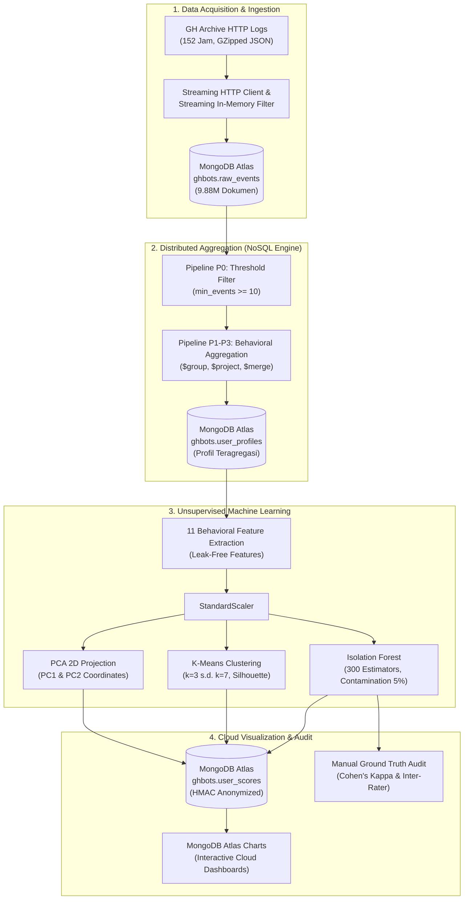

### 3.1 Tahap 1: Ingesti Skala Besar GH Archive

Log aktivitas publik diunduh secara terjadwal dari repositori publik [GH Archive](https://www.gharchive.org/). Data mentah berupa arsip JSON terkompresi per jam (`YYYY-MM-DD-H.json.gz`).
- **Jendela Observasi:** Dua blok jam temporal bersih tanpa missing-hour di kuartal 3 dan 4 tahun 2026.
  - **Blok A:** 11 Oktober 2026 08:00 UTC s.d. 14 Oktober 2026 13:00 UTC (**78 jam penuh**, 6.244.807 event bersih).
  - **Blok B:** 19 Oktober 2026 12:00 UTC s.d. 22 Oktober 2026 13:00 UTC (**74 jam penuh**, 3.639.406 event bersih).
  - **Total Data Bersih:** **9.884.213 event**.
- **Mekanisme Streaming:** File diekstraksi secara *in-memory* tanpa menyimpan berkas mentah berukuran puluhan gigabyte ke disk lokal. Hanya 8 tipe event utama yang dipertahankan (`PushEvent`, `CreateEvent`, `PullRequestEvent`, `PullRequestReviewEvent`, `PullRequestReviewCommentEvent`, `IssuesEvent`, `IssueCommentEvent`, `WatchEvent`, dan `ForkEvent`).

<div align="center">
  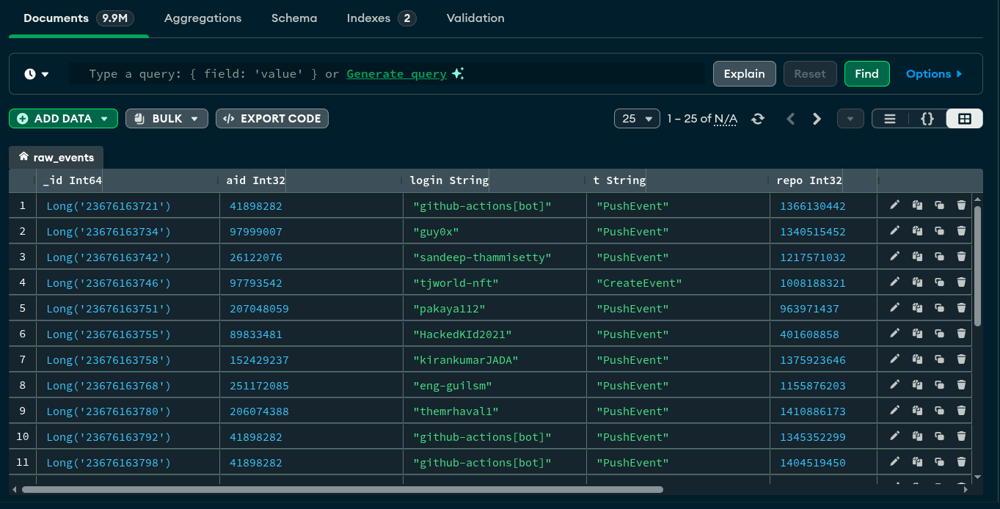
  <p><i>Gambar 1: Antarmuka MongoDB Atlas M10 yang mengelola 9.884.213 dokumen raw_events dengan ukuran kompresi disk ~474 MB dan indeks 398 MB.</i></p>
</div>

### 3.2 Tahap 2: Desain Basis Data NoSQL MongoDB Atlas

Sistem menggunakan database `ghbots` pada klaster **MongoDB Atlas M10** dengan konfigurasi mesin penyimpanan WiredTiger. Desain koleksi dan indeks dirancang untuk mendukung kueri analitik volume tinggi:

```
┌─────────────────────────────────────────────────────────────────────────────┐
│                    DESAIN SKEMA & STRUKTUR INDEKS ATLAS                     │
├─────────────────────────────────────────────────────────────────────────────┤
│ 1. Koleksi: raw_events                                                      │
│    - Skema: {_id: ObjectId, blok: String, aid: Long, login: String,         │
│              type: String, rid: Long, ts: ISODate}                          │
│    - Compound Index: { blok: 1, aid: 1, ts: 1 } (nama: blok_aid_ts)        │
│    - Range Index:    { ts: 1 } (nama: ts_1)                                 │
├─────────────────────────────────────────────────────────────────────────────┤
│ 2. Koleksi: user_profiles                                                   │
│    - Hasil agregasi per akun per blok melalui stage $group dan $merge       │
│    - Menyimpan statistik komputasi: n, n_repos, max_repo, jam_aktif, hod    │
├─────────────────────────────────────────────────────────────────────────────┤
│ 3. Koleksi: user_scores                                                     │
│    - Sinkronisasi hasil machine learning untuk integrasi Atlas Charts       │
│    - Kunci unik: { blok: 1, id_anon: 1 }                                   │
│    - Menyimpan nilai kontinu skor anomali, klaster, flag anomali, dan PCA   │
└─────────────────────────────────────────────────────────────────────────────┘
```

Penyusunan profil dilakukan melalui agregasi bertahap:
- **P0:** Mengidentifikasi akun yang memenuhi ambang batas aktivitas minimal ($n \ge 10$) menggunakan indeks `blok_aid_ts`.
- **P1:** Menghitung distribusi event per jenis aktivitas dan memetakan identitas login.
- **P2:** Menghitung jumlah repositori unik yang disentuh (`$addToSet: "$rid"`) serta rasio dominansi repositori utama.
- **P3:** Menghitung jam aktif unik, beban puncak aktivitas per jam tunggal, dan sebaran 24 jam (*Hour of Day / HOD*).
Hasil komputasi disatukan langsung ke dalam koleksi `user_profiles` menggunakan operator `$merge` secara *in-place*.

### 3.3 Tahap 3: Pipeline Machine Learning & Feature Engineering

Untuk menghindari bias identitas dan potensi kebocoran data (*data leakage*), model pembelajaran mesin dibangun secara eksklusif menggunakan **11 fitur perilaku murni** tanpa menyertakan username, ID akun, maupun nama repositori:

<table>
  <thead>
    <tr>
      <th>Fitur</th>
      <th>Simbol Matematis</th>
      <th>Deskripsi Perilaku & Rasionalisasi</th>
    </tr>
  </thead>
  <tbody>
    <tr>
      <td><code>log_n</code></td>
      <td>$\ln(1 + n)$</td>
      <td>Transformasi logaritmik total aktivitas event untuk meredam skewness distribusi skala bebas (power-law).</td>
    </tr>
    <tr>
      <td><code>frac_push</code></td>
      <td>$n_{\text{push}} / n$</td>
      <td>Proporsi aktivitas pengiriman commit kode (PushEvent).</td>
    </tr>
    <tr>
      <td><code>frac_create</code></td>
      <td>$n_{\text{create}} / n$</td>
      <td>Proporsi pembuatan entitas baru seperti repository, branch, atau tag (CreateEvent).</td>
    </tr>
    <tr>
      <td><code>frac_pr</code></td>
      <td>$n_{\text{PR}} / n$</td>
      <td>Proporsi keterlibatan dalam Pull Request (pembukaan PR, review, dan komentar review).</td>
    </tr>
    <tr>
      <td><code>frac_issue</code></td>
      <td>$n_{\text{issue}} / n$</td>
      <td>Proporsi interaksi pada pelacakan tiket/masalah (IssuesEvent & IssueCommentEvent).</td>
    </tr>
    <tr>
      <td><code>frac_social</code></td>
      <td>$n_{\text{social}} / n$</td>
      <td>Proporsi aktivitas sosial jejaring (pemberian bintang / WatchEvent dan percabangan / ForkEvent).</td>
    </tr>
    <tr>
      <td><code>log_events_per_repo</code></td>
      <td>$\ln(1 + n / n_{\text{repos}})$</td>
      <td>Rerata intensitas event per repositori target. Mengidentifikasi bot yang membanjiri satu repo vs menyebar tipis.</td>
    </tr>
    <tr>
      <td><code>max_repo_share</code></td>
      <td>$n_{\text{max\_repo}} / n$</td>
      <td>Rasio konsentrasi aktivitas pada repositori yang paling sering diakses ($0 \le x \le 1$).</td>
    </tr>
    <tr>
      <td><code>hour_entropy</code></td>
      <td>$-\sum p_i \log_2(p_i) / \log_2(24)$</td>
      <td>Entropi informasi Shannon atas sebaran aktivitas selama 24 jam sehari (0 = 1 jam aktif; 1 = merata 24 jam tanpa tidur).</td>
    </tr>
    <tr>
      <td><code>active_frac</code></td>
      <td>$j_{\text{aktif}} / J_{\text{blok}}$</td>
      <td>Fraksi durasi jam aktif terhadap total rentang jam pengamatan dalam blok temporal.</td>
    </tr>
    <tr>
      <td><code>log_max_per_hour</code></td>
      <td>$\ln(1 + \max(n_h))$</td>
      <td>Transformasi logaritmik lonjakan event tertinggi dalam rentang satu jam tunggal.</td>
    </tr>
  </tbody>
</table>

#### Pemodelan Deteksi Anomali & Klasterisasi
1. **Standardisasi:** Data dinormalisasi menggunakan `StandardScaler` ($\mu = 0, \sigma = 1$).
2. **Isolation Forest:** Dikonfigurasi dengan `n_estimators=300`, estimasi kontaminasi teratas 5% (`TOP_PERSEN = 5`), dan skor anomali kontinu didefinisikan sebagai $S(x) = -\text{score\_samples}(x)$ di mana nilai yang lebih besar mencerminkan derajat anomali yang lebih tinggi.
3. **K-Means Clustering:** Dilakukan evaluasi jumlah klaster optimal ($k \in [2, 8]$) berbasis *Silhouette Score*. Model memilih $k=7$ pada Blok B dan $k=3$ pada Blok A untuk memetakan sub-populasi perilaku.
4. **Principal Component Analysis (PCA):** Memproyeksikan matriks 11 dimensi ke dalam 2 komponen utama (PC1 dan PC2) untuk visualisasi spasial sebaran populasi bot vs pengembang normal.

<div align="center">
  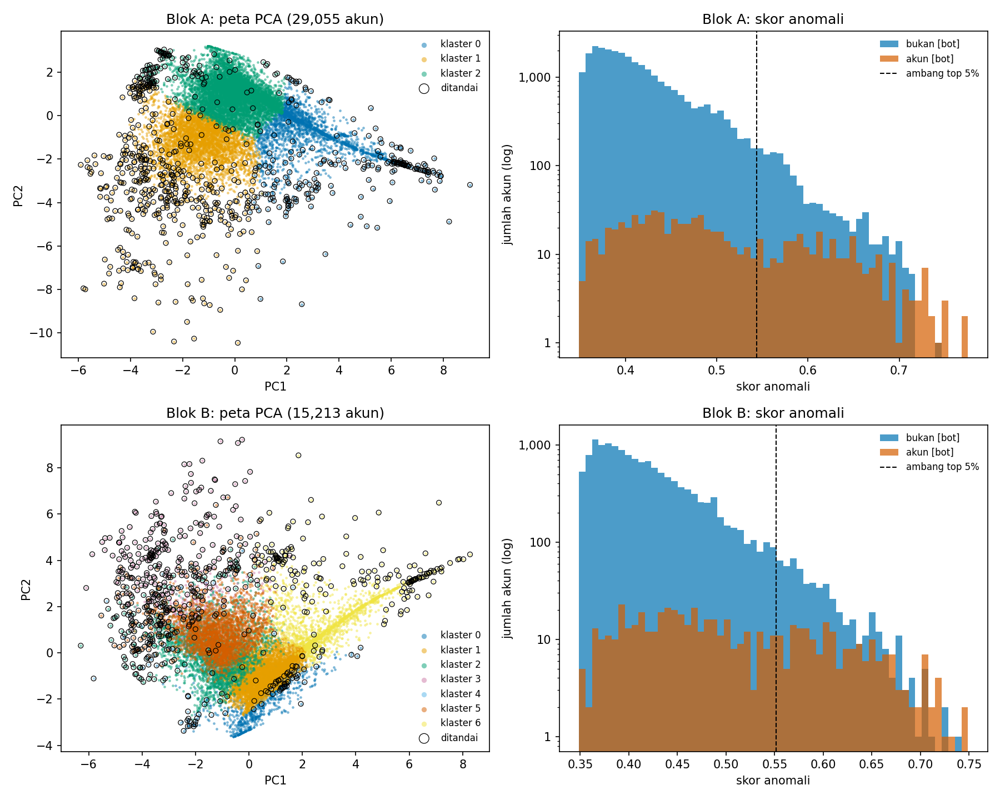
  <p><i>Gambar 2: Proyeksi PCA 2D (kiri) memperlihatkan klaster perilaku dengan penandaan anomali (lingkaran hitam), serta histogram distribusi skor anomali skala logaritmik (kanan) membedakan akun resmi [bot] dengan akun umum.</i></p>
</div>

### 3.4 Tahap 4: Sinkronisasi Balik & Visual Analytics

Data inferensi model disinkronisasikan kembali ke MongoDB Atlas pada koleksi `ghbots.user_scores` menggunakan operasi batch `UpdateOne` dengan opsi `upsert=True`. Username dari akun pengguna biasa dianonimisasi menggunakan hash kriptografis **HMAC-SHA256**, sedangkan nama aplikasi resmi (misal: `dependabot[bot]`) dipertahankan sebagai label referensi publik.

Integrasi visualisasi awan dibangun menggunakan **MongoDB Atlas Charts** untuk menyediakan pemantauan analitik waktu-nyata:

<div align="center">
  <table>
    <tr>
      <td align="center">
        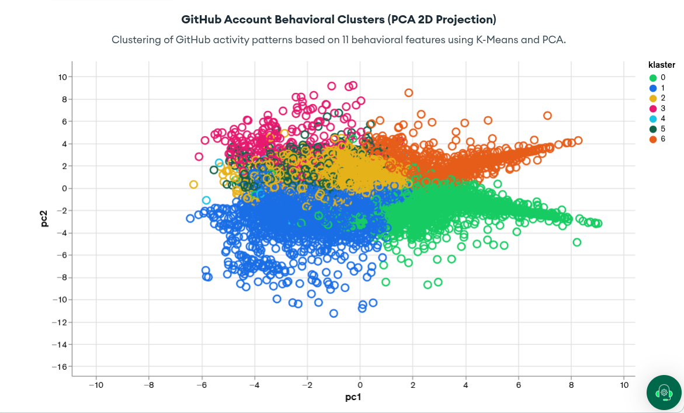<br>
        <b>(a) Proyeksi Sebaran PC1 vs PC2 Berbasis Klaster</b>
      </td>
      <td align="center">
        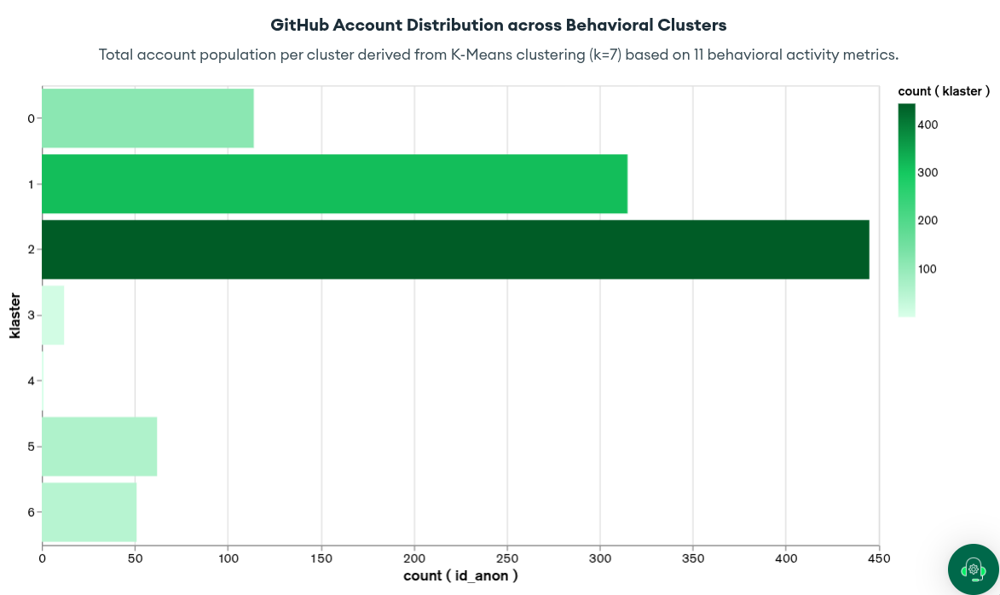<br>
        <b>(b) Distribusi Populasi Akun per Klaster Perilaku</b>
      </td>
    </tr>
  </table>
  <p><i>Gambar 3: Dashboard analitik cloud pada MongoDB Atlas Charts untuk eksplorasi interaktif hasil klasterisasi K-Means dan anomali Isolation Forest.</i></p>
</div>

---

## 4. Hasil Eksperimen & Evaluasi Kuantitatif

### 4.1 Perbandingan Deteksi Anomali vs Baseline Volume

Model dievaluasi menggunakan label akun yang memiliki sufiks resmi `[bot]` sebagai *pseudo-ground truth*. Penting dicatat bahwa label ini sama sekali tidak pernah diikutsertakan dalam pelatihan model. Performa Isolation Forest dibandingkan dengan baseline univariat sederhana (hanya berdasarkan total volume event $n$) serta peluang acak (*random guessing*):

<table>
  <thead>
    <tr>
      <th rowspan="2">Blok Temporal</th>
      <th rowspan="2">Populasi Akun</th>
      <th rowspan="2">Akun Berlabel [bot]</th>
      <th colspan="2">Isolation Forest (11 Fitur)</th>
      <th colspan="2">Baseline Volume ($n$)</th>
      <th rowspan="2">Presisi @ Top-k</th>
      <th rowspan="2">Ambang $k$</th>
      <th rowspan="2">PR-AUC Acak</th>
    </tr>
    <tr>
      <th>ROC-AUC</th>
      <th>PR-AUC</th>
      <th>ROC-AUC</th>
      <th>PR-AUC</th>
    </tr>
  </thead>
  <tbody>
    <tr>
      <td><b>Blok A</b> ($n \ge 20$)</td>
      <td>29.055</td>
      <td>767</td>
      <td><b>0.774</b></td>
      <td><b>0.171</b></td>
      <td>0.595</td>
      <td>0.055</td>
      <td>17.3%</td>
      <td>1.453</td>
      <td>0.026</td>
    </tr>
    <tr>
      <td><b>Blok B</b> ($n \ge 20$)</td>
      <td>15.213</td>
      <td>584</td>
      <td><b>0.781</b></td>
      <td><b>0.215</b></td>
      <td>0.593</td>
      <td>0.077</td>
      <td>25.6%</td>
      <td>761</td>
      <td>0.038</td>
    </tr>
  </tbody>
</table>

#### Analisis Sensitivitas Ambang Batas Aktivitas Minimal ($n$)
Eksperimen sensitivitas dilakukan untuk mengevaluasi ketahanan model terhadap tingkat keaktifan akun ($n \ge 10$, $n \ge 20$, dan $n \ge 50$):

<table>
  <thead>
    <tr>
      <th>Blok</th>
      <th>Min Event ($n$)</th>
      <th>Total Akun</th>
      <th>Label [bot]</th>
      <th>ROC-AUC IF</th>
      <th>PR-AUC IF</th>
      <th>ROC-AUC Volume</th>
      <th>PR-AUC Volume</th>
      <th>Presisi @ Top-k</th>
      <th>k</th>
      <th>PR-AUC Acak</th>
    </tr>
  </thead>
  <tbody>
    <tr>
      <td rowspan="3" align="center"><b>A</b></td>
      <td>10</td>
      <td>69.825</td>
      <td>1.385</td>
      <td>0.772</td>
      <td>0.132</td>
      <td>0.595</td>
      <td>0.040</td>
      <td>13.1%</td>
      <td>3.492</td>
      <td>0.020</td>
    </tr>
    <tr>
      <td>20</td>
      <td>29.055</td>
      <td>767</td>
      <td>0.774</td>
      <td>0.171</td>
      <td>0.595</td>
      <td>0.055</td>
      <td>17.3%</td>
      <td>1.453</td>
      <td>0.026</td>
    </tr>
    <tr>
      <td>50</td>
      <td>9.095</td>
      <td>354</td>
      <td><b>0.788</b></td>
      <td><b>0.207</b></td>
      <td>0.583</td>
      <td>0.084</td>
      <td>24.8%</td>
      <td>455</td>
      <td>0.039</td>
    </tr>
    <tr style="border-top: 2px solid #ccc;">
      <td rowspan="3" align="center"><b>B</b></td>
      <td>10</td>
      <td>37.889</td>
      <td>1.079</td>
      <td>0.759</td>
      <td>0.159</td>
      <td>0.604</td>
      <td>0.057</td>
      <td>17.4%</td>
      <td>1.895</td>
      <td>0.028</td>
    </tr>
    <tr>
      <td>20</td>
      <td>15.213</td>
      <td>584</td>
      <td>0.781</td>
      <td>0.215</td>
      <td>0.593</td>
      <td>0.077</td>
      <td>25.6%</td>
      <td>761</td>
      <td>0.038</td>
    </tr>
    <tr>
      <td>50</td>
      <td>4.550</td>
      <td>244</td>
      <td><b>0.809</b></td>
      <td><b>0.301</b></td>
      <td>0.591</td>
      <td>0.122</td>
      <td><b>39.5%</b></td>
      <td>228</td>
      <td>0.054</td>
    </tr>
  </tbody>
</table>

> [!NOTE]
> Peningkatan ambang $n \ge 50$ pada Blok B mendorong nilai **ROC-AUC mencapai 0.809** dan **PR-AUC 0.301**, membuktikan bahwa pada akun dengan rekam jejak aktivitas yang cukup, Isolation Forest mampu memisahkan pola otomasi dengan presisi hingga **5.6x lebih tinggi** dibandingkan probabilitas acak.

---

### 4.2 Kestabilan Temporal Lintas Waktu (Cross-Block Generalizability)

Salah satu tantangan mendasar dalam deteksi bot adalah ketahanan temporal: apakah model mendeteksi anomali sesaat (*transient noise*) atau pola perilaku persisten?

Uji kestabilan dilakukan dengan membandingkan 8.475 akun yang muncul secara konsisten di Blok A dan Blok B:

<div align="center">
  <table>
    <thead>
      <tr>
        <th>Metrik Evaluasi Temporal</th>
        <th>Nilai Eksperimen</th>
        <th>Nilai Baseline / Ekspektasi Acak</th>
        <th>Interpretasi Statistik</th>
      </tr>
    </thead>
    <tbody>
      <tr>
        <td><b>Akun Bersama (A & B)</b></td>
        <td><code>8.475</code> akun</td>
        <td>-</td>
        <td>Sampel overlap antar jendela waktu 1 minggu.</td>
      </tr>
      <tr>
        <td><b>Korelasi Peringkat Spearman ($r$)</b></td>
        <td><code>0.720</code></td>
        <td>0.000 ($p < 0.001$)</td>
        <td>Korelasi sangat kuat dan searah pada skor anomali akun antar blok.</td>
      </tr>
      <tr>
        <td><b>Rekurensi Deteksi (Top-5%)</b></td>
        <td><code>52.9%</code></td>
        <td>5.2% (Peluang Acak)</td>
        <td>Akun yang terindikasi anomali di Blok A memiliki probabilitas <b>10.2x lebih besar</b> untuk terindikasi kembali di Blok B.</td>
      </tr>
    </tbody>
  </table>
</div>

Hasil ini membuktikan bahwa sifat otomasi yang ditangkap oleh 11 fitur perilaku bersifat deterministik dan berkelanjutan dalam jangka panjang.

---

### 4.3 Evaluasi Kinerja Kueri NoSQL & Analisis Indeks

Untuk mengevaluasi keandalan basis data dalam melayani beban analitik Big Data, dilakukan pengujian kinerja komparatif antara eksekusi tanpa indeks (`COLLSCAN`, pemindaian penuh seluruh koleksi) melawan pemanfaatan indeks majemuk dan indeks rentang (`IXSCAN`, `ts_1`).

<div align="center">
  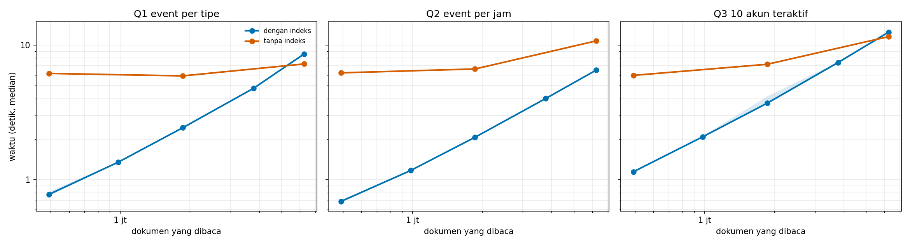
  <p><i>Gambar 4: Profil waktu eksekusi kueri agregasi NoSQL terhadap pertambahan volume dokumen (kiri ke kanan) serta faktor percepatan indeks (speedup) hingga 9.0x lipat.</i></p>
</div>

Berikut adalah ringkasan hasil uji benchmark pada rentang waktu pengamatan:

<table>
  <thead>
    <tr>
      <th>Kueri Agregasi</th>
      <th>Jendela Jam</th>
      <th>Dokumen Terpindai</th>
      <th>Tanpa Indeks (dtk)</th>
      <th>Plan Tanpa Indeks</th>
      <th>Dengan Indeks (dtk)</th>
      <th>Plan Dengan Indeks</th>
      <th>Indeks Terpakai</th>
      <th>Faktor Percepatan</th>
    </tr>
  </thead>
  <tbody>
    <tr>
      <td rowspan="3"><b>Q1: Distribusi Event per Tipe</b></td>
      <td>6 Jam</td>
      <td>490.725</td>
      <td>6.152 s</td>
      <td><code>COLLSCAN</code></td>
      <td><b>0.778 s</b></td>
      <td><code>IXSCAN</code></td>
      <td><code>ts_1</code></td>
      <td><b>7.9x</b></td>
    </tr>
    <tr>
      <td>24 Jam</td>
      <td>1.864.673</td>
      <td>5.899 s</td>
      <td><code>COLLSCAN</code></td>
      <td><b>2.433 s</b></td>
      <td><code>IXSCAN</code></td>
      <td><code>ts_1</code></td>
      <td><b>2.4x</b></td>
    </tr>
    <tr>
      <td>78 Jam</td>
      <td>6.244.807</td>
      <td>7.232 s</td>
      <td><code>COLLSCAN</code></td>
      <td>8.572 s</td>
      <td><code>IXSCAN</code></td>
      <td><code>ts_1</code></td>
      <td>0.8x</td>
    </tr>
    <tr style="border-top: 2px solid #ccc;">
      <td rowspan="3"><b>Q2: Histogram Event per Jam</b></td>
      <td>6 Jam</td>
      <td>490.725</td>
      <td>6.213 s</td>
      <td><code>COLLSCAN</code></td>
      <td><b>0.692 s</b></td>
      <td><code>IXSCAN</code></td>
      <td><code>ts_1</code></td>
      <td><b>9.0x</b></td>
    </tr>
    <tr>
      <td>24 Jam</td>
      <td>1.864.673</td>
      <td>6.639 s</td>
      <td><code>COLLSCAN</code></td>
      <td><b>2.067 s</b></td>
      <td><code>IXSCAN</code></td>
      <td><code>ts_1</code></td>
      <td><b>3.2x</b></td>
    </tr>
    <tr>
      <td>78 Jam</td>
      <td>6.244.807</td>
      <td>10.728 s</td>
      <td><code>COLLSCAN</code></td>
      <td><b>6.510 s</b></td>
      <td><code>IXSCAN</code></td>
      <td><code>ts_1</code></td>
      <td><b>1.6x</b></td>
    </tr>
    <tr style="border-top: 2px solid #ccc;">
      <td rowspan="3"><b>Q3: Top-10 Akun Paling Aktif</b></td>
      <td>6 Jam</td>
      <td>490.725</td>
      <td>5.951 s</td>
      <td><code>COLLSCAN</code></td>
      <td><b>1.146 s</b></td>
      <td><code>IXSCAN</code></td>
      <td><code>ts_1</code></td>
      <td><b>5.2x</b></td>
    </tr>
    <tr>
      <td>24 Jam</td>
      <td>1.864.673</td>
      <td>7.192 s</td>
      <td><code>COLLSCAN</code></td>
      <td><b>3.702 s</b></td>
      <td><code>IXSCAN</code></td>
      <td><code>ts_1</code></td>
      <td><b>1.9x</b></td>
    </tr>
    <tr>
      <td>78 Jam</td>
      <td>6.244.807</td>
      <td>11.532 s</td>
      <td><code>COLLSCAN</code></td>
      <td>12.431 s</td>
      <td><code>IXSCAN</code></td>
      <td><code>ts_1</code></td>
      <td>0.9x</td>
    </tr>
    <tr style="border-top: 2px solid #ccc;">
      <td><b>Q4: Riwayat Akun (Median, 17 event)</b></td>
      <td>Penuh</td>
      <td>17</td>
      <td>5.951 s</td>
      <td><code>COLLSCAN</code></td>
      <td>6.148 s</td>
      <td><code>COLLSCAN</code></td>
      <td>-</td>
      <td>1.0x</td>
    </tr>
    <tr>
      <td><b>Q4: Riwayat Akun (Terbanyak, 1.03M)</b></td>
      <td>Penuh</td>
      <td>1.033.781</td>
      <td>23.590 s</td>
      <td><code>COLLSCAN</code></td>
      <td>20.570 s</td>
      <td><code>COLLSCAN</code></td>
      <td>-</td>
      <td>1.1x</td>
    </tr>
    <tr>
      <td><b>Q5: Top-10 Akun Blok Penuh</b></td>
      <td>Penuh</td>
      <td>6.244.807</td>
      <td>11.600 s</td>
      <td><code>COLLSCAN</code></td>
      <td>11.220 s</td>
      <td><code>COLLSCAN</code></td>
      <td>-</td>
      <td>1.0x</td>
    </tr>
  </tbody>
</table>

> [!TIP]
> **Temuan Kinerja Arsitektur:** Indeks sekunder `ts_1` memberikan peningkatan efisiensi yang dramatis (**hingga 9.0x**) pada kueri analitik dengan selektivitas tinggi (rentang waktu $\le 24$ jam). Namun, pada jendela selektivitas rendah ($\ge 78$ jam di mana kueri menyentuh $>60\%$ total dokumen), *overhead* pembacaan indeks B-Tree (random I/O) mendekati biaya pemindaian sekuensial memori, mengonfirmasi teori optimasi basis data engine WiredTiger.

---

### 4.4 Validasi Ground Truth Manual (Inter-Rater Reliability)

Karena akun stealth bot tidak memiliki label resmi di GitHub Archive, kami menerapkan protokol audit manual *double-blind* independen oleh dua orang penilai ahli pada 60 akun acak tanpa label `[bot]` (30 akun ditandai anomali oleh model vs 30 akun tidak ditandai):

<table>
  <thead>
    <tr>
      <th>Kelompok Akun</th>
      <th>Total Sampel ($n$)</th>
      <th>Dinilai Pasti</th>
      <th>Terbukti Bot Nyata</th>
      <th>Proporsi Bot (%)</th>
      <th>95% Interval Kepercayaan (CI)</th>
      <th>Tingkat Kesepakatan (Cohen's Kappa)</th>
    </tr>
  </thead>
  <tbody>
    <tr>
      <td><b>Kelompok Ditandai (Anomali Model)</b></td>
      <td>30</td>
      <td>27</td>
      <td><b>14</b></td>
      <td><b>51.9%</b></td>
      <td>[34.0% &ndash; 69.3%]</td>
      <td rowspan="2" align="center"><b>$\kappa = 1.000$</b><br><i>(Perfect Agreement)</i></td>
    </tr>
    <tr>
      <td><b>Kelompok Tidak Ditandai (Normal)</b></td>
      <td>30</td>
      <td>29</td>
      <td>10</td>
      <td>34.5%</td>
      <td>[19.9% &ndash; 52.7%]</td>
    </tr>
  </tbody>
</table>

Skor **Cohen's Kappa $\kappa = 1.0$** menegaskan bahwa penilai mencapai konsensus mutlak tanpa perbedaan interpretasi atas bukti aktivitas di profil GitHub. Proporsi bot sejati pada kelompok yang ditandai terbukti **1.5x lebih tinggi** daripada kelompok yang tidak ditandai.

---

## 5. Tipologi & Studi Kasus Bot Nyata

Melalui inspeksi kualitatif pada akun-akun non-`[bot]` dengan skor anomali tertinggi, kami mengidentifikasi empat arketipe otomasi yang beroperasi secara bebas di GitHub:

### 5.1 Black-Hat SEO / Gambling Spam Campaign (`mccartyashley284`)

Akun ini merupakan bagian dari jaringan bot terkoordinasi yang memanfaatkan GitHub sebagai repositori backlink ilegal untuk memanipulasi peringkat mesin pencari (*search engine manipulation*).

<div align="center">
  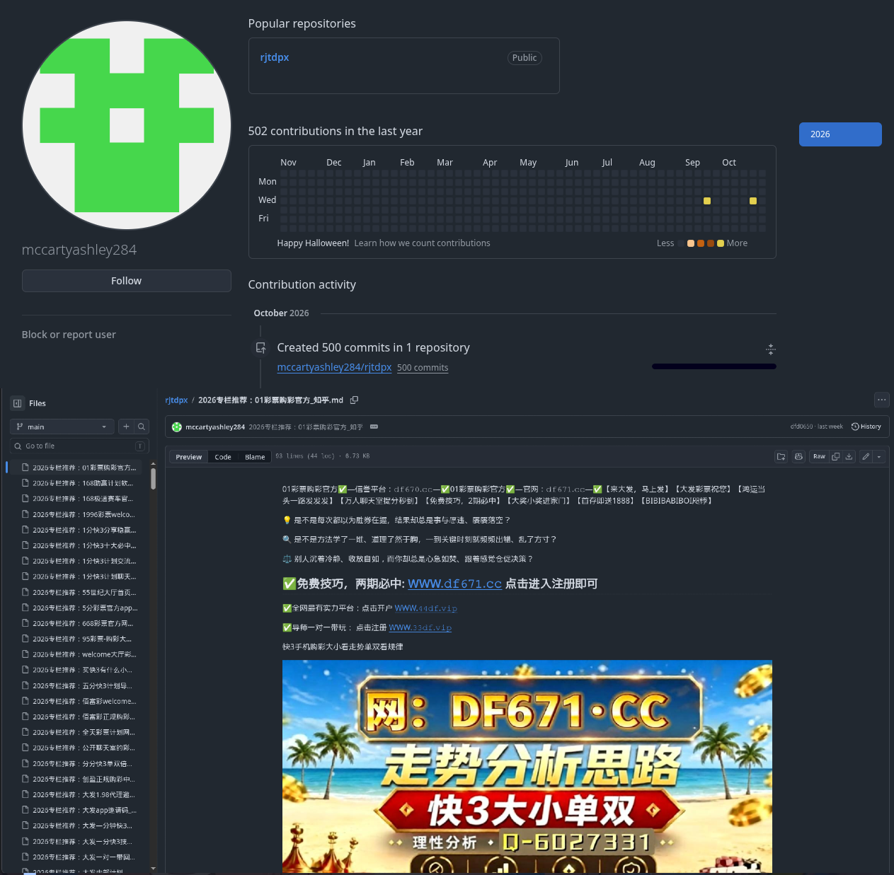
  <p><i>Gambar 5: Tangkapan layar repositori akun mccartyashley284 yang memublikasikan berkas Markdown promosi platform judi online secara masif.</i></p>
</div>

- **Karakteristik Metrik:** $n=35$ event terkompresi dalam rentang singkat ($j_{\text{aktif}} = 2$), $100\%$ push event (`frac_push = 1.0`), menyasar $1$ repositori utama (`max_repo_share = 1.0`).
- **Pola Aktivitas:** Menghasilkan commit cepat yang memuat file Markdown berisi puluhan kata kunci perjudian dan tautan afiliasi. Akun tidak memiliki rekam jejak kolaborasi manusia seperti diskusi Issue atau Pull Request.

---

### 5.2 Extreme Loop / Green-Wall Spoofer (`nonkh`, `hamzaalmobayed`)

Tipe ini mewakili pengembang yang menjalankan skrip otomasi personal berbasis cron-job atau loop tak terhingga (*infinite loop*) untuk memalsukan grafik kontribusi hijau (*contribution graph*) pada profil publik GitHub mereka.

<div align="center">
  <table>
    <tr>
      <td align="center">
        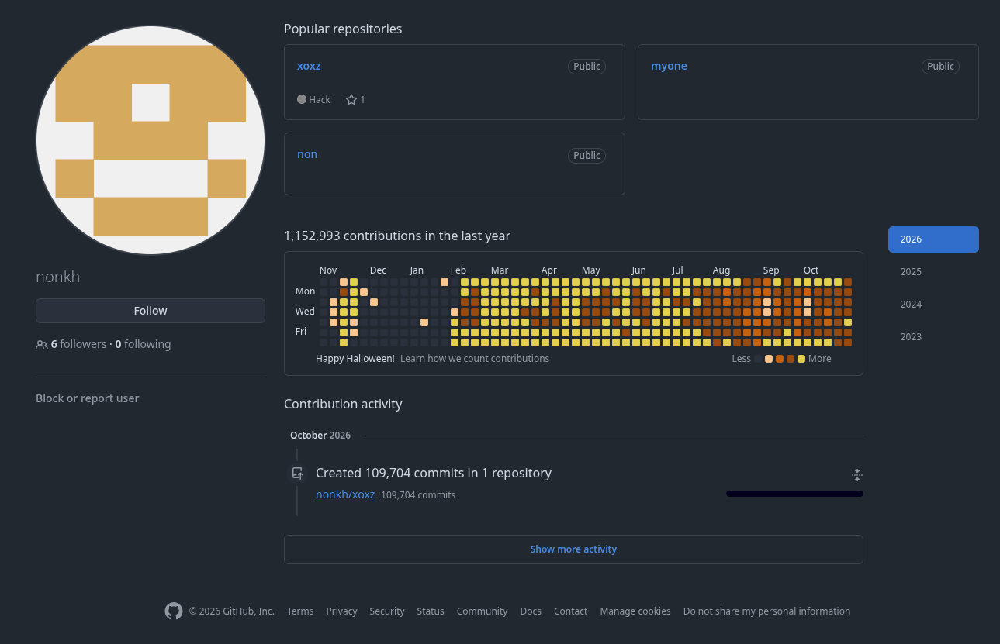<br>
        <b>(a) Profil Akun nonkh (1.868 Event / 78 Jam Aktif)</b>
      </td>
      <td align="center">
        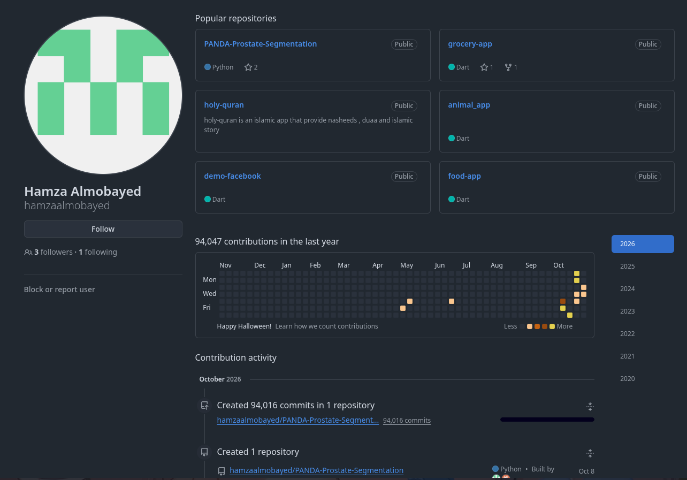<br>
        <b>(b) Profil Akun hamzaalmobayed (566 Push / 12 Jam)</b>
      </td>
    </tr>
  </table>
  <p><i>Gambar 6: Pola aktivitas looping commit ekstrem untuk memalsukan grafik kontribusi portofolio.</i></p>
</div>

- **Akun `nonkh`:** Mencatatkan **1.868 push event** pada 1 repositori tunggal selama **78 jam penuh tanpa jeda** (`active_frac = 1.0`, `hour_entropy = 0.98`). Entropi jam mendekati 1 membuktikan akun melakukan commit sepanjang 24 jam sehari tanpa pola tidur biologis manusia.
- **Akun `hamzaalmobayed`:** Mengirimkan **566 push event** dalam jendela 12 jam berturut-turut pada 1 repositori personal secara berulang dan teratur.

---

### 5.3 Autonomous Agent / Automated CI Runner (`rob531`, `liferay-continuous-integration`)

Kategori ini mencakup akun *service runner* atau *agent automation* yang beroperasi pada infrastruktur integrasi berkelanjutan (CI/CD) mandiri tanpa mendaftar sebagai GitHub App.

<div align="center">
  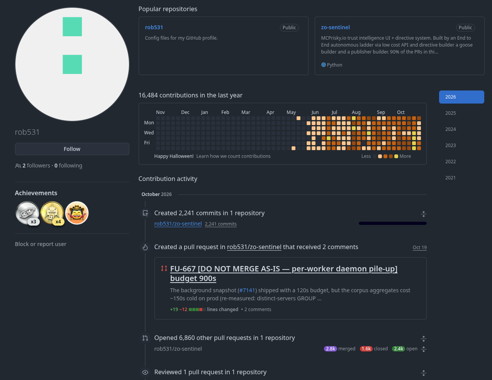
  <p><i>Gambar 7: Jejak aktivitas akun otomasi pengujian kode dan pembuatan Pull Request otonom pada akun rob531.</i></p>
</div>

- **Akun `rob531`:** 151 event selama 47 jam aktif dengan rasio didominasi oleh `CreateEvent` ($52\%$) dan interaksi `PullRequest` ($28\%$). Pola ini identik dengan bot pembuat branch pengujian dan runner evaluasi kode otomatis.
- **Akun `liferay-continuous-integration`:** Akun otomasi skala korporasi yang mengelola 73 event terdistribusi di **19 repositori berbeda** secara simultan (`frac_issue = 0.44`, `frac_pr = 0.33`), tetapi didaftarkan menggunakan akun pengguna biasa tanpa label resmi.

---

### 5.4 Financial Trading EA Auto-Deployer (`hiro-kurage`)

Akun otomasi yang dikonfigurasi untuk menyinkronkan parameter perdagangan valuta asing (*forex algorithmic trading*) dan sinyal MetaTrader Expert Advisor (EA).

<div align="center">
  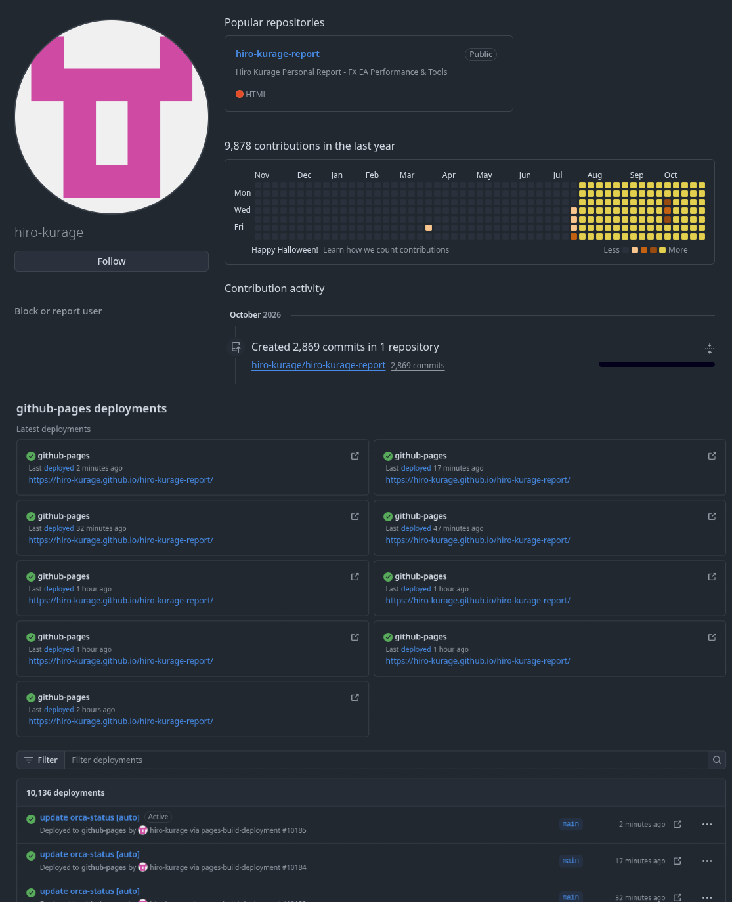
  <p><i>Gambar 8: Repositori akun hiro-kurage yang menerima commit pembaruan kode EA secara otomatis setiap jam.</i></p>
</div>

- **Karakteristik Metrik:** $n=24$ event push murni (`frac_push = 1.0`) yang terjadi pada interval berkala sepanjang **22 jam aktif** pada satu repositori trading privat/publik. Pola commit menunjukkan penulisan log otomatis yang dipicu oleh eksekusi trading bot.

---

## 6. Struktur Direktori Repositori

Proyek ini disusun dengan struktur modular yang memisahkan kode pipeline terintegrasi, dokumentasi eksperimen, dan aset visual:

```
big-data/
├── README.md                             # Dokumentasi komprehensif proyek (berkas ini)
├── github_bot_detection_pipeline.ipynb   # Unified Jupyter Notebook pipeline (Bagian 1 s.d. 4)
│
├── docs/                                 # Data mentah dan artefak hasil evaluasi model
│   ├── kestabilan.json                   # Metrik korelasi Spearman dan rekurensi lintas blok
│   ├── kinerja_ringkasan.csv             # Data benchmark kueri NoSQL (COLLSCAN vs IXSCAN)
│   ├── sensitivitas.csv                  # Hasil evaluasi model pada berbagai ambang aktivitas
│   ├── uji_manual_ringkasan.csv          # Hasil uji manual double-blind (Cohen's Kappa)
│   ├── validasi.csv                      # Metrik evaluasi ROC-AUC dan PR-AUC model vs baseline
│   └── waktu_pipeline.csv                # Rekaman durasi eksekusi tiap tahapan agregasi
│
└── images/                               # Aset visualisasi resolusi tinggi & studi kasus
    ├── atlas_charts_bar_clusters.png     # Dashboard Atlas Charts: Distribusi klaster K-Means
    ├── atlas_charts_pca_scatter.png      # Dashboard Atlas Charts: Proyeksi 2D PCA interaktif
    ├── atlas_raw_events_9.9M.png         # Tangkapan layar koleksi MongoDB Atlas (9.88M data)
    ├── hamzaalmobayed.png                # Bukti studi kasus bot: Extreme green-wall spoofer
    ├── hiro-kurage.png                   # Bukti studi kasus bot: Financial trading auto-deployer
    ├── kinerja_kueri.png                 # Grafik benchmark kueri NoSQL indeks vs tanpa indeks
    ├── mccartyashley284.png              # Bukti studi kasus bot: Black-hat SEO gambling spam
    ├── nonkh.png                         # Bukti studi kasus bot: Loop commit kontinu 78 jam
    ├── peta_dan_skor.png                 # Gambar 4-panel PCA & sebaran skor anomali IF
    └── rob531.png                        # Bukti studi kasus bot: Autonomous CI runner agent
```

---

## 7. Panduan Replikasi & Eksekusi Pipeline

Seluruh alur eksperimen disatukan ke dalam satu berkas notebook: [`github_bot_detection_pipeline.ipynb`](github_bot_detection_pipeline.ipynb). Notebook ini dirancang agar dapat dijalankan secara langsung di Google Colab.

### 7.1 Prasyarat & Lingkungan
- Akun Google Colab (disarankan menggunakan runtime GPU/High-RAM jika memproses >10 juta event).
- Klaster MongoDB Atlas (direkomendasikan Tier M10 atau lebih tinggi dengan storage $\ge 10\text{ GB}$).
- Python versi 3.10 atau yang lebih baru.

### 7.2 Konfigurasi Rahasia (Colab Secrets)
Sebelum menjalankan pipeline, tambahkan kredensial berikut pada menu **Secrets (ikon kunci)** di Google Colab:
- `MONGODB_URI`: URI koneksi lengkap ke klaster Atlas Anda, contoh:
  ```text
  mongodb+srv://<username>:<password>@cluster0.xxxxx.mongodb.net/ghbots?retryWrites=true&w=majority
  ```
- `HMAC_KEY`: String rahasia acak untuk pembuatan pseudonim username yang konsisten.

### 7.3 Parameter Eksekusi Notebook
Pada sel pertama (Form Pengaturan), sesuaikan saklar eksekusi sesuai kebutuhan:

```python
# Pengaturan Saklar Eksekusi Modular
SKIP_UNDUH        = True    # Set False jika ingin mengunduh ulang log dari GH Archive
SKIP_MUAT         = True    # Set False untuk memuat data mentah ke MongoDB Atlas
HAPUS_DAN_ULANG   = False   # HATI-HATI: True menghapus raw_events dan memuat ulang dari nol
HITUNG_ULANG      = False   # True jika ingin mengulang agregasi user_profiles di Atlas
JALANKAN_OPSIONAL = True    # Menjalankan evaluasi uji manual dan visualisasi tambahan
```

---

## 8. Etika Pengelolaan Data, Keamanan, & Privasi

Penelitian ini mematuhi prinsip-prinsip etika rekayasa data dan privasi komputasi:

1. **Anonimisasi Kriptografis (Pseudonymization):** Seluruh identitas akun pengembang non-`[bot]` dienkripsi menggunakan fungsi hash satu arah ber-kunci (**HMAC-SHA256**) sebelum diekspor ke berkas publik atau disinkronkan ke MongoDB Atlas Charts.
2. **Kepatuhan Privasi Data:** Tidak ada data pribadi sensitif (PII), alamat email, nomor telepon, maupun konten kode privat yang diunduh atau disimpan. Seluruh data bersumber dari log peristiwa publik yang disediakan secara sah oleh GitHub Archive API.
3. **Prinsip "Kandidat Bot" (Non-Defamation):** Akun yang memiliki skor anomali tinggi didefinisikan secara akademis sebagai **"kandidat mirip-bot"** (*bot-like candidate*) berdasarkan keanehan statistik perilaku, bukan sebagai penetapan definitif akun berbahaya (*malicious actor*).
4. **Sanitasi Kredensial:** Seluruh token otentikasi, kata sandi klaster, dan URI basis data telah disanitasi dari repositori dan hanya diakses melalui variabel lingkungan runtime (*Secrets Management*). Aturan *Network Access* `0.0.0.0/0` pada Atlas hanya diaktifkan secara temporer selama pengujian Colab berlangsung.

Kami menyampaikan apresiasi mendalam kepada tim penyedia layanan [GH Archive](https://www.gharchive.org/) atas penyediaan arsip publik aktivitas GitHub, serta [MongoDB for Academia](https://www.mongodb.com/academia) yang telah mendukung penyediaan infrastruktur komputasi awan klaster Atlas M10.

---

<div align="center">
  <sub>Dikelola oleh Tim PBL Big Data 2026 &bull; Program Studi Sistem Informasi &bull; Universitas Riau</sub>
</div>
